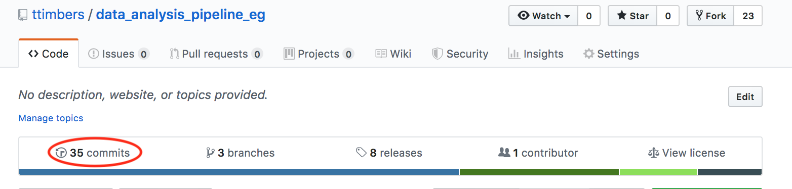
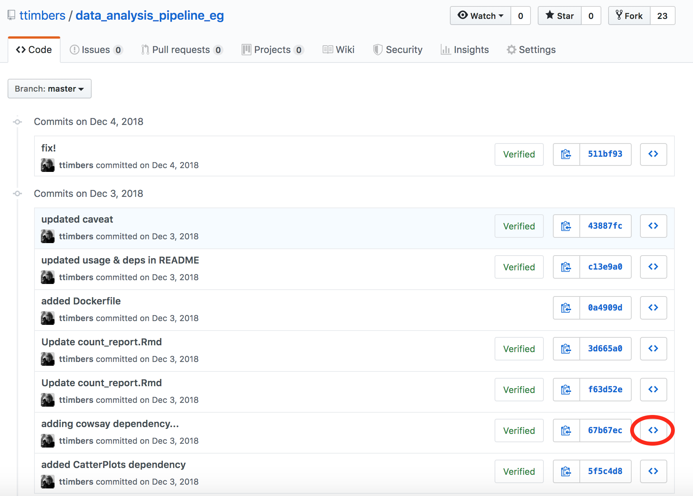
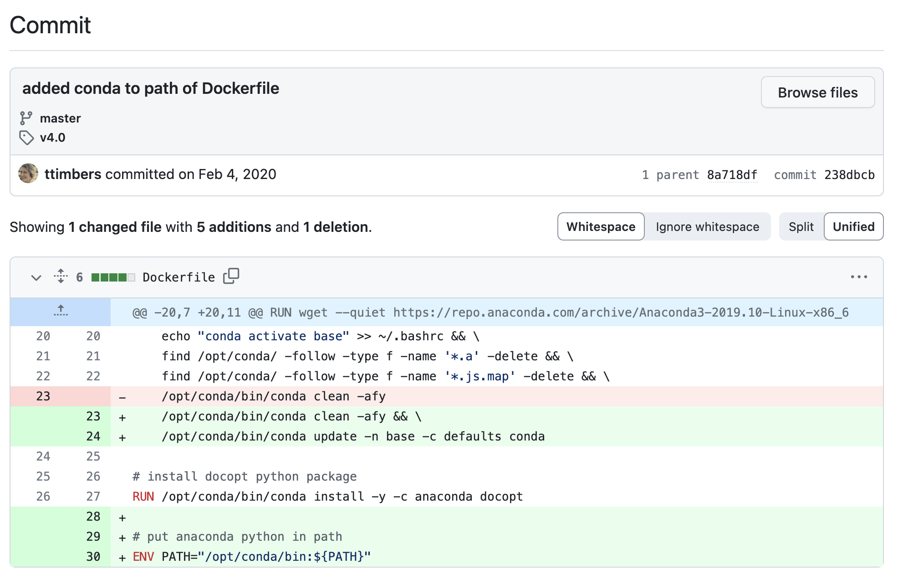

<!-- Note about this chapter:
we are using bash highlighting for the terminal commands and sh highlighting for output
-->

## Learning Objectives {.unnumbered}



Now let's see how we can use the commits we've made to look at files in the past
or reverting a file to a version from the past.

## Just going for a look:

The easiest way to go back in time in your version control repository is to use the GitHub.com website. To do this, we click the commits link:



Then we can view the history, along with the commit messages. To view the state of a repository at that time, we click on the "**<>**" button:



## Travelling in time or bringing something something from the back from the past:

Sometimes you want to be able to explore and run the files from the past, or bring a past version of a file to the future. When we need to do either of those things, we should be working with Git in our local repository.

Here's the same history as viewed above, but using the Git command line:

```bash
git log
```

```sh
commit cab2e6a93f113602974390f64e88dad0a5d6eae3 (HEAD -> master, origin/master, origin/HEAD)
Author: Tiffany Timbers <tiffany.timbers@gmail.com>
Date:   Thu Dec 9 10:33:39 2021 -0800

    added example using docker-compose.yml

commit b9c1bdcdc0cf8f7bce3fd3874cce0e76b6c474e3 (tag: v4.0)
Merge: 238dbcb 9b4af1d
Author: Tiffany A. Timbers <tiffany.timbers@gmail.com>
Date:   Tue Feb 4 10:49:23 2020 -0800

    Merge pull request #1 from kguidonimartins/master

    Update README.md

commit 238dbcb02a77acb21b251aff7ff954f8c22a91bc
Author: ttimbers <tiffany.timbers@stat.ubc.ca>
Date:   Tue Feb 4 10:47:03 2020 -0800

    added conda to path of Dockerfile

commit 9b4af1d03c282a2d747d642a0c8847fd53b4f1d7
:
```

The <kbd>:</kbd> at the end tells us there are more commits than shown.
You can navigate this log by scrolling with the mouse, arrow keys,
<kbd>b</kbd> key, or by pressing <kbd>space</kbd>.

This log is also searchable.
Press <kbd>/</kbd> + search term + <kbd>return</kbd> to search for a word.
<kbd>n</kbd>/<kbd>N</kbd>
goes to next/previous match for the search term.

To exit from the Git history log, we press the <kbd>q</kbd>
(short for "quit") character.

To see what was changed at a given point in history,
we can use the `git show` command.
For example we can view what was changed
in the commit with the message
"added conda to path of Dockerfile"
which has the long SHA `238dbcb02a77acb21b251aff7ff954f8c22a91bc`
we would type:

```bash
git show 238dbcb
```

:::{.callout-note}
We only used the first 7 digits of the long SHA
(we call this the short SHA).
This is usually unique enough for Git to autofill in the rest for us.
:::


```sh
commit 238dbcb02a77acb21b251aff7ff954f8c22a91bc
Author: ttimbers <tiffany.timbers@stat.ubc.ca>
Date:   Tue Feb 4 10:47:03 2020 -0800

    added conda to path of Dockerfile

diff --git a/Dockerfile b/Dockerfile
index 05ad853..faf3918 100644
--- a/Dockerfile
+++ b/Dockerfile
@@ -20,7 +20,11 @@ RUN wget --quiet https://repo.anaconda.com/archive/Anaconda3-2019.10-Linux-x86_6
     echo "conda activate base" >> ~/.bashrc && \
     find /opt/conda/ -follow -type f -name '*.a' -delete && \
     find /opt/conda/ -follow -type f -name '*.js.map' -delete && \
-    /opt/conda/bin/conda clean -afy
+    /opt/conda/bin/conda clean -afy && \
+    /opt/conda/bin/conda update -n base -c defaults conda

 # install docopt python package
 RUN /opt/conda/bin/conda install -y -c anaconda docopt
+
+# put anaconda python in path
+ENV PATH="/opt/conda/bin:${PATH}"
```

## Travelling in time to the past

:::{.activity}

Here's the website view of the same commit:



[Source](https://github.com/ttimbers/data_analysis_pipeline_eg/commit/238dbcb02a77acb21b251aff7ff954f8c22a91bc)

How similar are the local and webpage log views?
Do you get the same information from both? Which seems easier to read/navigate?
Which would be more useful for testing out your code?

:::

If you wanted to move your project's file and directories (so entire state) back to this point in time you can do that by running `git checkout <commit-id> .`. The last `.` is really important, so don't forget it!

Let's do this now to go back to the point just before
the changes we explored above:

```bash
git checkout 9b4af1d .
```

When we look at the `Dockerfile` (the file that was changed in the commit after this)
we see it does not have the changes we viewed in the `238dbcb`!
Also, if you run `git log` you will see the more recent commits in your history are GONE!

Don't panic! We can go back to the future!
To get there (where we were before we started time travelling,
we can use `git checkout` the `HEAD` commit nickname:

```bash
git checkout HEAD .
```

> Note: `HEAD` is the nickname for the most recent commit in a GitHub repository.

Now, let's check our `git log` to make sure we returned safely!

```bash
git log
```

```sh
commit cab2e6a93f113602974390f64e88dad0a5d6eae3 (HEAD -> master, origin/master, origin/HEAD)
Author: Tiffany Timbers <tiffany.timbers@gmail.com>
Date:   Thu Dec 9 10:33:39 2021 -0800

    added example using docker-compose.yml

commit b9c1bdcdc0cf8f7bce3fd3874cce0e76b6c474e3 (tag: v4.0)
Merge: 238dbcb 9b4af1d
Author: Tiffany A. Timbers <tiffany.timbers@gmail.com>
Date:   Tue Feb 4 10:49:23 2020 -0800

    Merge pull request #1 from kguidonimartins/master

    Update README.md

commit 238dbcb02a77acb21b251aff7ff954f8c22a91bc
Author: ttimbers <tiffany.timbers@stat.ubc.ca>
Date:   Tue Feb 4 10:47:03 2020 -0800

    added conda to path of Dockerfile

commit 9b4af1d03c282a2d747d642a0c8847fd53b4f1d7
Author: Karlo Guidoni Martins <kguidonimartins@gmail.com>
Date:   Tue Feb 4 13:04:39 2020 -0300

    Update README.md

    Remove the duplicate `### Usage:` header.
:
```

:::{.exercise}

1. Clone [this GitHub repository](https://github.com/ttimbers/data_analysis_pipeline_eg) to your computer.

2. View the names of the files that were changed in commit `44c17be`, and the specific changes made to the file `doc/count_report.Rmd`.

3. Checkout the  `44c17be` commit and explore it locally.

4. Then go back to where you started (remember to use the nickname `HEAD`).

:::


## Bringing something something from the back from the past

:::{.activity}
Say we decided to return to a point in the past, and restart our work from there?
How would we do that?
:::


There is not a nice and easy way (that I am aware of) of cherry-picking a version of single file from the past using the JupyterLab Git extension. To do this, I resort to the Git command line tool in the terminal. The general command is:

```bash
git checkout <HASH> <FILE>
```

For example, to checkout the version of the `doc/count_report.Rmd` from the commit whose hash starts with `5837143`, we would type:

```bash
git checkout 5837143 doc/count_report.Rmd
```

That will bring that version of the `doc/count_report.Rmd` into our working directory. We can view it, run it or use it, et cetera. If we want to keep that version going forward for our project, we would have to then add and commit that version of the file to do so.

## What Git tool to use?

There are many many many different tools for using Git. We have so far discussed two in this class (the JupyterLab Git extension,
and the Git command line). Others include GitHub Desktop, GitKraken, Source Tree, RStudio's Git GUI, and VSCode's Git GUI.
Which one should you use? Anyone that fits you best! I recommend experimenting with a few and then settling in with the one
that you find easiest to use. One note is that some commands are limited in some tools (e.g., the example above with the
JupyterLab Git extension). If you hit that case in your favorite tool, you can use the Git command line tool to get around it
and then go back to primarily using your tool of choice.
