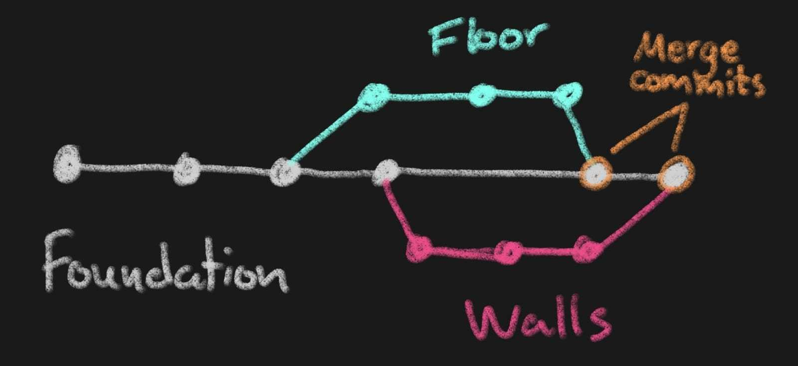
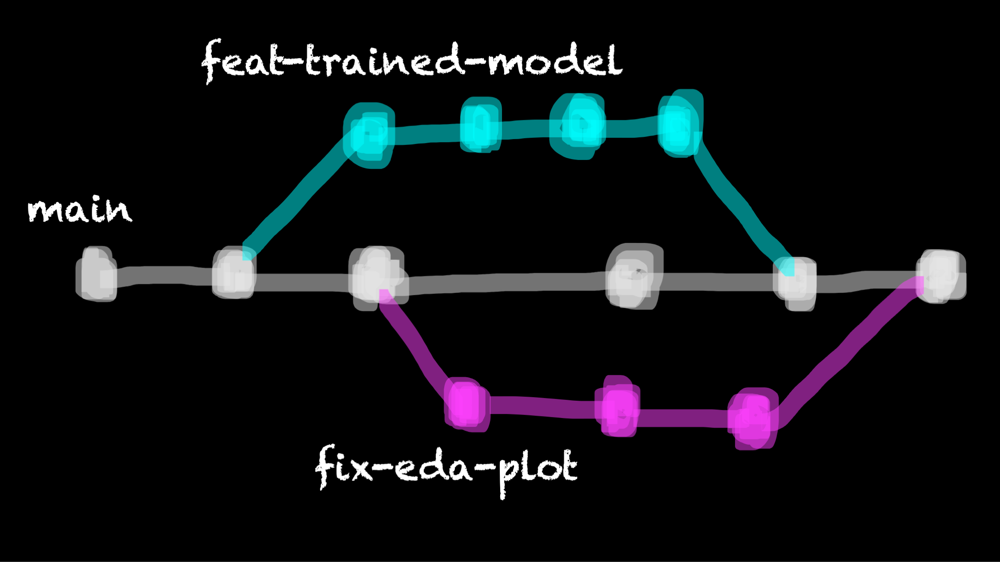
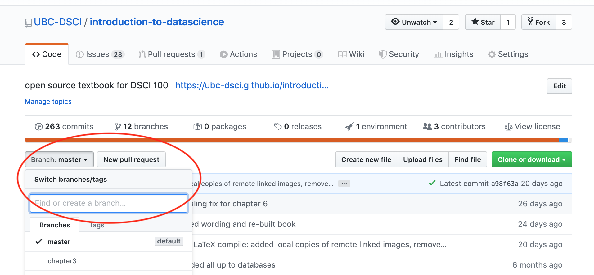
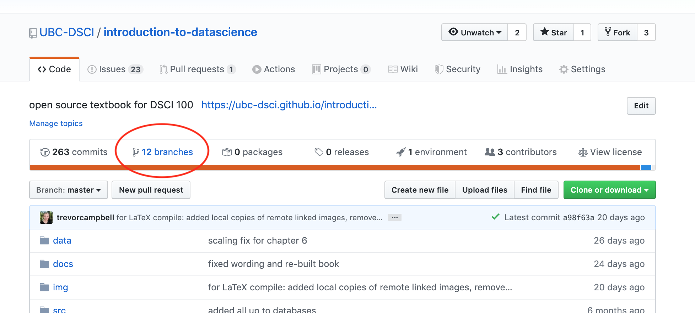
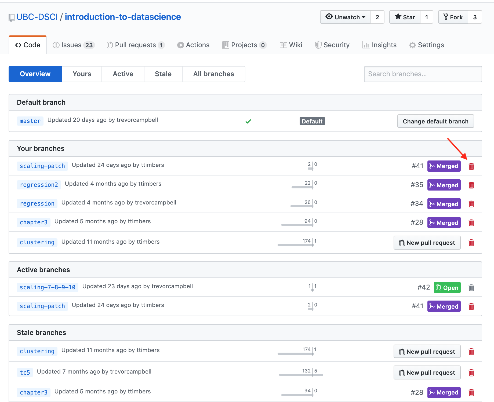

<!-- Note about this chapter:
we are using bash highlighting for the terminal commands and sh highlighting for output
-->

## Learning Objectives {.unnumbered}



Branches allow you to have a playground
for developing and testing new additions to your code,
as well as fixes.
This playground lets your explore, experiment and test
in a safe place - away from others that might be using
or depending on the current version of your code.
This is perhaps more obviously useful if your project
is deployed and has users (e.g., a data visualization dashboard,
an R or Python package, a phone app, etc),
but this can also be useful for code that make up a data analyses.
As, in addition to the reasons stated above for branching,
branching also lets you organize units of work into smaller,
more manageable chunks that are easier for collaborators to check over and review.

Once the new code additions or fixes have been
finalized in their branch playground,
they can be merged back to the main code-base.
Several branch playgrounds can co-exist,
one for each new code addition or fix being worked on.
This allows for parallelization of work!

We can use a construction of a house
as a metaphor for this kind of development.
First,
you need to build the foundation.
Since everything depends on the foundation being built,
this would be developed on the main branch.
When the foundation is finished,
the construction of other parts of the house that don't depend on each other
could take place in parallel,
e.g. some contributors might start working on the walls and others on the floor.
When either of these features is finished,
it can be added back to the house
(merged into main).
When depicted graphically,
this process would look something like this
(each dot is a commit).



A more realistic Git branching example for a data analysis project might look something like this:



## Creating a branch using the command line

In the terminal, and in the working directory of the project in which you wish to create a branch,
use `git switch` with the `-c` flag and specify the branch name.
This create a new branch and immediately switch to it.
For example, to create a branch named `patch-docs`
(a good branch name if we were planning on working on a fix
in the project's documentation),
we would type:

```bash
git switch -c patch-docs
```

To ask Git what branches now exist and to see where we are,
we can use the `branch` command with the `-v` flag
(for "verbose", meaning tell us everything!):

```bash
git branch -v
```

And we should see something like the output shown below,
which lists the branch names in the first column,
the SHA of the last commit on each branch in the second column,
and the commit message associated with the last commit in the third column:

```sh
  main       f756bbb initial
* patch-docs f756bbb initial
```

As you work here on this new branch,
you can commit your changes to version control locally,
and even push your changes to the remote repository.
All the changes however will live only on that branch
until you do something to move them to another branch.
When you want to start discussing your changes with your collaborators
to start the process of bringing these changes into the main branch (main code-base)
you typically create what is called a pull request.
A pull request is a like an asking your collaborators "is it OK to merge my code?"
Usually there will be some discussion and a few more revisions to the code,
but eventually they will give you the thumbs up when everything looks good
and the code can then be merged. We will discuss this more in [Pull requests](0310-github-pull-requests.qmd).

### Switching to branches that already exist

After you have been working on your new brain for some time,
you will eventually want to get back to the project's default branch,
or some other branch.
To do this, we use `git switch <branch_name>`.
Note that we do not use the `-c` flag this time, as we are not creating a new branch.

### Getting remote branches you did not create locally

If your collaborator creates a branch that you want to
run or test locally, but it only exists on the remote repository
you have to tell Git to fetch (go get it) for you first,
before you can switch to it.
You can specify which branch you specifically want to grab,
but for simplicity it is often easy to ask Git
to fetch all of them for you, using the `fetch` command
with the `--all` flag:

```bash
git fetch --all
```

### Useful command line Git branching commands

Below is a table of the most commonly used
Git commands for branching.
This table includes the commands we presented above
as well as the a few other useful ones.

| Description | Command |
|---------|-------------|
| list all local branches | `git branch -v` |
| create a new branch & immediately switch to it | `git switch -c <branch_name>` or `git checkout -b <branch_name>` |
| switch to a branch | `git switch <branch_name>` or `git checkout  <branch_name>` |
| fetches all changes to all branches | `git fetch --all` |
| retrieve a branch you don't have locally on your laptop from GitHub| `git checkout --track origin/<branch_name` |
| merge changes from another branch | `git merge <branch_name>` |
| delete a local branch | `git branch -d <branch_name>` |
| push changes to a remote branch | `git push origin <branch_name>` |

:::{.exercise}

1. Make your own copy of [this GitHub repository](https://github.com/ttimbers/sqrt) by clicking the green "Use this template" button. And then clone your copy of the repository to your computer.

2. Create a new branch named `better_error_msg` in the local repository using Git.

3. On that branch, fix the `sqrt.py` so that if you run this script with a negative number as an argument you do not get an difficult to understand error, but instead throw a helpful exception informing the user that the number should be positive. Fix to add to `sqrt.py`:

```python
if number < 0:
  raise Exception("n should not a positive number")
```

4. Add and commit those changes.

5. Switch back to the `main` branch and look at the `sqrt.py` file - do you see the change there?

6. Switch back to the `better_error_msg` branch - do you see the change there?

7. Push your change to the remote GitHub repository, and see where you can find it there!
:::

:::{.callout-note}
Note: if you use the Git command line tool and get an error message like the one shown below,
this is because you did not state the remote (usually it is `origin`).
Try pushing again using `git push origin <branch_name>`

```sh
fatal: The current branch better_error_msg has no upstream branch.
To push the current branch and set the remote as upstream, use
    git push --set-upstream origin better_error_msg
To have this happen automatically for branches without a tracking
upstream, see 'push.autoSetupRemote' in 'git help config'.
```
:::

## Useful things you can do with branches on GitHub

Create a new branch:



Source: <https://github.com/UBC-DSCI/introduction-to-datascience>

View all branches and their status:



Source: <https://github.com/UBC-DSCI/introduction-to-datascience>

And delete remote branches:



Source: <https://github.com/UBC-DSCI/introduction-to-datascience/branches>

## What happens when my feature branch falls behind main?

There are a few ways you can fix this problem.

### Using merge

> How to catch up a branch that has fallen behind the `main` branch using the command line:
>
> - run `git pull origin main` to pull any changes from the remote version of main that we might not have
> - run `git switch <branch>` to make sure we are on the branch we want to catch up
> - run `git merge main` to merge the changes
> - run `git push origin <branch>` to push our updated branch to the remote


### Using rebase

1. Make sure everything is committed in your new branch
2. Move to the main branch: `git switch main`
2. Make sure the main branch is up to date: `git pull origin main`
3. Move back over to your branch: `git switch <branch>`
4. Update the changes from main: `git rebase main`
