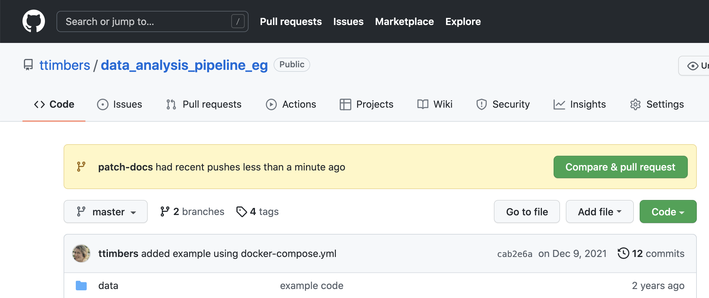
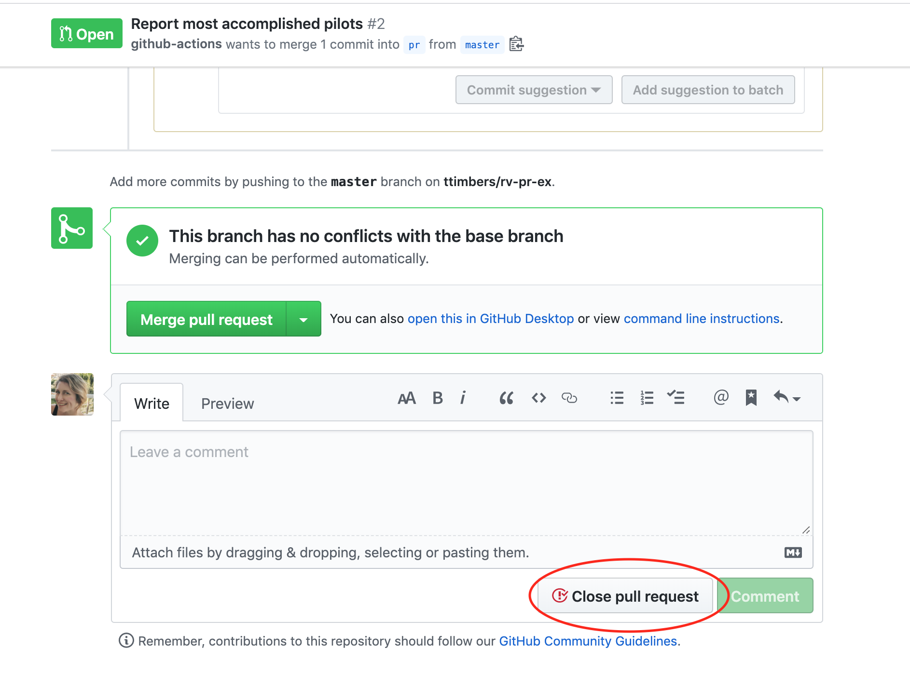

## Learning Objectives {.unnumbered}



## Creating a pull request

To create a pull request,
you first need to ensure all the local changes you made on the new branch
are also available on the remote repository
(i.e., you need to push them).
Once that has happened you need to
go to the remote GitHub repository,
as pull requests are created from there.

GitHub often tries to be helpful when a change
is pushed to a new branch that doesn't yet exist
on the default branch by showing you a yellow banner
listing any recently pushed branches.

To create a pull request,
you click the green button "Compare & pull request".
In the new page,
add a message to describe the changes you have made,
scroll down to review the changed files,
and the click the green button that reads "Create pull request".
If you are working together in a team,
you could also designate certain team members to review your work
and assign relevant labels,
via the right hand side panel.

The next step is for a collaborator to review your work
and merge it in if they approve it
(see [Code review on GitHub](0320-github-code-review.qmd)).

:::{.exercise title="Exercise 1"}

1. Use the green "Compare & pull request" button on the yellow banner to open a pull request.

2. Go to the "Pull requests" tab on the remote GitHub repository and explore the "Conversation" and "Files changed" sub-tabs there.
:::

## How do you not accept a pull request?

In some cases, it might not make sense to merge a pull request. To close a pull request that should not be merged, scroll to the bottom of the pull request page, and look for a gray "Closes pull request" button. This will end move the pull request to the closed pull requests section (similar to closed issues) and does not merge the changes.

