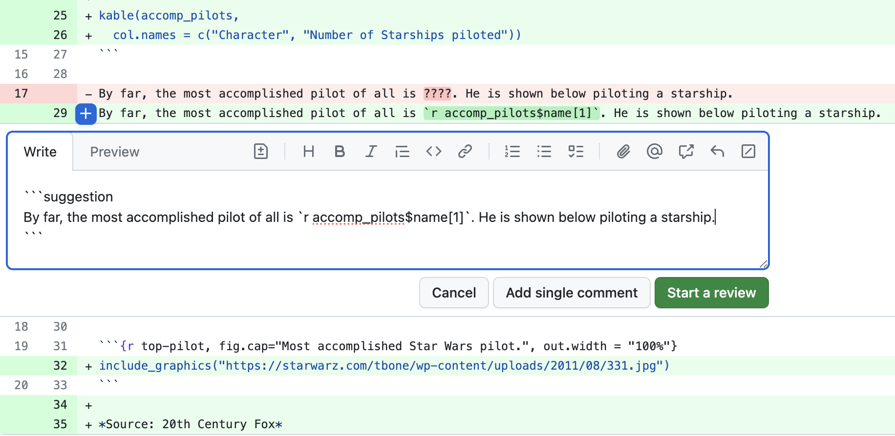
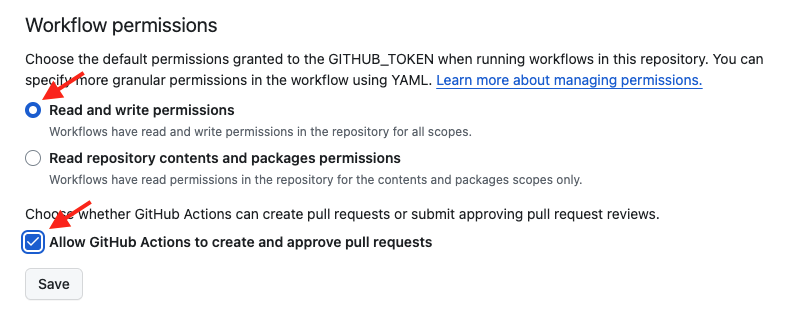

## Learning Objectives {.unnumbered}



We very often need to have a conversation to get pull requests into good shape before merging the changes into the `main` branch.
GitHub has a very nice tool we can utilize to do this: GitHub code reviews.
This tool allows us to add inline comments to proposed changes, as well as inline suggested changes that can be accepted with a click of a button. These features increase review efficiency and effectiveness!

- In the project, you are expected to read and review each other's code BEFORE accepting a pull request.

- Do not expect all (or even most) pull requests to be perfect in their first submission.

:::{.exercise title="Demo: do a code review"}

I am going to demo a code review of a pull request. I have set-up a template GitHub repository for you so that you can easily generate a pull request for you to review if you want to try this later.

**Steps:**

1. Click the green "Use this template" button in [this repository](https://github.com/ttimbers/review-my-pull-request) to obtain a copy of it for yourself (do not fork it).

2. Go to Repository Settings > Actions > General > under "Workflow permissions" make sure read and write permissions are enabled and also GitHub Actions is able to create and approve Pull Requests. Under "Actions permissions" select "Allow all actions and reuseable workflows". It should look like this:

  

3. Click on the Actions tab, and then click on the workflow `.github/workflows/pr.yml`. You then should see a **"Run workflow"** button with a drop down menu, from that menu select **"Run workflow"**.

3. Click on the Pull Requests tab of your copy of the repository, click on the pull request titled "Report most accomplished pilots", and then click on "Files Changed". Next click on the `star-wars.Rmd` file. Review the file and observe the following problems with the R Markdown report that was submitted via the pull request:
  - Reasoning of the sentence on line 15
  - Incompatibility with the sentence on line 15 with the code in the code chunk named `table-of-most-accomplished-pilots`
  - Incorrect code in code chunk named `table-of-most-accomplished-pilots` (unested `film` instead of `starships`) leads to naming the wrong pilot as the most accomplished pilot on line 19
  - Incorrect code in code chunk named `table-of-most-accomplished-pilots` (unested `film` instead of `starships`) leads to the use of the wrong character's picture in the image that is sourced in the code chunk named `top-pilot` (it should be a picture of Obi-Wan Kenobi, you could use this URL for example: <https://hips.hearstapps.com/hmg-prod.s3.amazonaws.com/images/ewan-mcgregor-obi-wan-1570898048.jpg>).

4. Add comments and suggested changes using the `+` sign beside the line numbers (the first time you do this will trigger the start of your code review. Need help? See [GitHub's how to on reviewing proposed changes in a pull request](https://help.github.com/en/github/collaborating-with-issues-and-pull-requests/reviewing-proposed-changes-in-a-pull-request).

5. After you have made all the comments and suggested changes, then add a general comment for the code review, select "Request Changes" and submit your code review.
:::

:::{.exercise title="Demo: Accept suggested changes from a code review"}

**Steps:**

1. To accept the code changes that you provided as suggestions, revisit the Pull Requests tab of your copy of the repository and clicking on the pull request titled "Report most accomplished pilots". Scroll through the pull request comments and find the code suggestions. Then click on the "Commit suggestion button" for each suggestion.

2. Click on the "Show all reviewers" link beside the red "Changes requested"" text. Then click on the `...` beside the reviewer and click "Approve changes".

3. Finally click on the green buttons ("Merge Pull Request" & "Confirm merge") to merge the pull request.
:::

:::{.activity title="Discussion"}

If I didn't tell you what to review, could you really have done a good job reviewing the code only on GitHub?

*Hint: if I didn't tell you that the top pilot was Obi-Wan Kenobi, how would you have known that?*

:::
