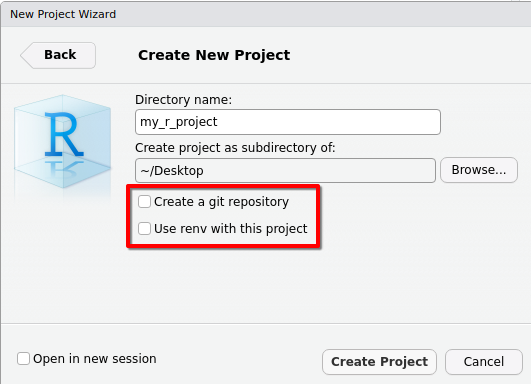

:::{.callout-note title="Adapted from DSCI 521"}
This chapter is adapted from the DSCI 521 notes,
[Virtual Environments: R](https://ubc-mds.github.io/DSCI_521_platforms-dsci_book/lectures/virtual-environments-renv.html).
If you took DSCI 521, it is review.
:::

## Learning Objectives {.unnumbered}



## R environments

In R,
environments are managed by `renv`,
which works with similar principles as `uv`
and other virtual environment managers,
but the commands are different.
To see which commands are used in `renv`,
you can visit the project website:
<https://rstudio.github.io/renv/articles/renv.html>.

Briefly,

- `renv::init()` creates a new environment in the current directory or project.
- `renv::snapshot()` saves the environment to a file, `renv.lock`.
  Installing and removing packages are done as usual
  with the `install.packages()` and `remove.packages()` commands.
- `renv::restore()` updates the current environment from the `renv.lock` file.

`renv` assumes and enforces the "one project, one environment" mantra of virtual environments.
`conda` lets you "activate" an environment and move across different projects.
`renv`, like `uv`, prefers it when all your work is contained in a single project.
Each project, for example each assignment repository, gets its own `renv` environment.

:::{.activity}
Which of the following commands is used to initialize a new `renv` environment in an R project?

A.  `renv::create()`
B.  `renv::activate()`
C.  `renv::init()`
D.  `renv::start()`

:::

One of the other distinguishing factors between R and Python is CRAN, the package repository for R.
CRAN checks every package it hosts, every day,
and removes packages that stop working with the rest of CRAN,
so on any given calendar day the packages on CRAN are meant to install together.

## An example R project

Here we'll go through an example of using `renv` in the context of an RStudio project.
As with `uv`, you don't "activate" and "deactivate" it manually.
One of the nice things is `renv` works naturally within an RStudio project.

The New Project creation wizard in RStudio has an option to enable
the folder as a git repository, and also to set it up with `renv`.
This does the same thing as running `renv::init()` in the current project.

{fig-alt="RStudio's New Project Wizard, creating my_r_project in ~/Desktop, with the Create a git repository and Use renv with this project checkboxes outlined in red."}

Our project has one script, `analysis.R`, that uses `dplyr`:

```{.r filename="analysis.R"}
library(dplyr)

species_counts <- starwars |>
  count(species, sort = TRUE)
```

Running `renv::init()` in the project gives:

```r
renv::init()
```

```out
- Linking packages into the project library ... Done!
The following package(s) will be updated in the lockfile:

# CRAN -----------------------------------------------------------------------
- cli          [* -> 3.6.6]
- dplyr        [* -> 1.2.1]
- generics     [* -> 0.1.4]
- glue         [* -> 1.8.1]
- lifecycle    [* -> 1.0.5]
- magrittr     [* -> 2.0.5]
- pillar       [* -> 1.11.1]
- pkgconfig    [* -> 2.0.3]
- R6           [* -> 2.6.1]
- renv         [* -> 1.3.1]
- rlang        [* -> 1.3.0]
- tibble       [* -> 3.3.1]
- tidyselect   [* -> 1.2.1]
- utf8         [* -> 1.2.6]
- vctrs        [* -> 0.7.3]
- withr        [* -> 3.0.3]

The version of R recorded in the lockfile will be updated:
- R            [* -> 4.6.2]

- Lockfile written to "~/Desktop/my_r_project/renv.lock".
```

We never told `renv` about `dplyr`,
yet it is in the lockfile,
along with every package `dplyr` depends on.

:::{.callout-tip title="New since DSCI 521"}
`renv` found `dplyr` by reading our code.
By default, `renv::init()` and `renv::snapshot()` scan the project's R files
for `library()` and `require()` calls (and `pkg::` uses)
and record the packages they find.
`renv` calls this an **implicit** snapshot,
and it is the setting stored in `renv/settings.json`:

```{.default filename="renv/settings.json"}
  "snapshot.type": "implicit",
```

With implicit snapshots, your code *is* the list of packages the project declares.
[renv: declaring packages in `DESCRIPTION`](0565-virtual-environments-r-renv-description.qmd)
builds on this with an **explicit** list instead.
:::

### Environment files

When you either create a new project with `renv` enabled or run `renv::init()`
in the current working directory (`getwd()`),
a few new files will be created:

1. `.Rprofile` in the current project directory
2. `renv/` directory
3. `renv.lock` file

Before we talk about what each file and directory does,
now when you start a new R session or re-open your RStudio project,
you will see a line that will read something like:

```out
- Project '~/Desktop/my_r_project' loaded. [renv 1.3.1]
```

How does R know that the project uses `renv`?
It's because of the `.Rprofile` file.
This is a special file that R will read at the start of __every__ session.
R reads up to two startup profiles, in this order:

1. the site-wide profile, `Rprofile.site` in the R installation, if it exists
2. one user profile, `.Rprofile`,
   from the current project or working directory,
   or, only if there is none there, from your home directory

So a project's `.Rprofile` is read *instead of* the one in your home directory,
not as well as it.

There is a similar file called `.Renviron` that only stores key-value environment variables,
and R looks for it in the same two places, in the same order.
You can read more about these initialization files
in R's own documentation, [`?Startup`](https://search.r-project.org/R/refmans/base/html/Startup.html).

The `renv` `.Rprofile` will add a single line:

```{.r filename=".Rprofile"}
source("renv/activate.R")
```

This is the line that "activates" the `renv` environment for you automatically,
assuming you are in the correct working directory.

All the environment files and packages are installed in the `renv/` directory.
This directory has its own `.gitignore` file that will ignore the correct things for you in that directory,
so you do not need to worry about checking in your entire set of packages.

Finally, the `renv.lock` file is the file that contains all the packages used in the repository,
their versions, and where they were installed from (e.g., CRAN or GitHub).

### Snapshot packages

When you install and use R packages in your project,
you will occasionally run `renv::snapshot()`.
This will update the `renv.lock` file with all the packages and dependencies for you.
Do not forget to `add`, `commit`, and `push` this file to your remote repository.

Say we add `library(tidyr)` to `analysis.R`.
`renv::status()` notices that the code now uses a package that is not installed:

```r
renv::status()
```

```out
- The project is out-of-sync -- use `renv::status()` for details.
The following package(s) are used in this project, but are not installed:
- tidyr

See `?renv::status` for advice on resolving these issues.
```

Install it as usual:

```r
install.packages("tidyr")
```

```out
The following package(s) will be installed:
- cpp11   [0.5.5]
- purrr   [1.2.2]
- stringi [1.8.9]
- stringr [1.6.0]
- tidyr   [1.3.2]
These packages will be installed into "~/Desktop/my_r_project/renv/library/macos/R-4.6/aarch64-apple-darwin23".

# Installing packages --------------------------------------------------------
✔ stringi 1.8.9                            [linked from cache]
✔ stringr 1.6.0                            [linked from cache]
✔ cpp11 0.5.5                              [linked from cache]
✔ tidyr 1.3.2                              [linked from cache]
✔ purrr 1.2.2                              [linked from cache]
Successfully installed 5 packages in 7.6 milliseconds.
```

`[linked from cache]` means `renv` had downloaded these versions before,
for another project,
and linked them in instead of downloading them again,
the same idea as `uv`'s cache.

Then snapshot, so the lockfile records it:

```r
renv::snapshot()
```

```out
The following package(s) will be updated in the lockfile:

# CRAN -----------------------------------------------------------------------
- cpp11     [* -> 0.5.5]
- purrr     [* -> 1.2.2]
- stringi   [* -> 1.8.9]
- stringr   [* -> 1.6.0]
- tidyr     [* -> 1.3.2]

- Lockfile written to "~/Desktop/my_r_project/renv.lock".
```

Unlike `uv add`, installing a package does not update the lockfile.
Until you run `renv::snapshot()`,
your collaborators will not get the package.

### Restore packages

As you work on a project with other people and packages get updated,
you will occasionally run `renv::restore()`
to install any missing packages on your local R environment.
Occasionally `renv` may tell you things are out of sync and will
prompt you to run `renv::status()` or `renv::restore()`.

Here is a collaborator's fresh clone of the project,
which has the committed files but no `renv/library/`:

```r
renv::restore()
```

```out
# Bootstrapping renv 1.3.1 ---------------------------------------------------
- Using renv 1.3.1 from global package cache
- None of the packages recorded in the lockfile are currently installed.
- Use `renv::restore()` to restore the project library.
The following package(s) will be updated:

# CRAN -----------------------------------------------------------------------
- cli          [* -> 3.6.6]
- cpp11        [* -> 0.5.5]
- dplyr        [* -> 1.2.1]
...

# Installing packages --------------------------------------------------------
✔ tidyselect 1.2.1                         [linked from cache]
✔ magrittr 2.0.5                           [linked from cache]
...
✔ purrr 1.2.2                              [linked from cache]
Successfully installed 20 packages in 16 milliseconds.
```

(shortened)

## renv and uv side by side

| Job | `renv` (R) | `uv` (Python) |
| --- | --- | --- |
| Start an environment in a project | `renv::init()` | `uv init --bare` |
| Install a package | `install.packages()` | `uv add` |
| Record what you got in the lockfile | `renv::snapshot()` | `uv lock` (`uv add` does it for you) |
| Recreate the environment from the lockfile | `renv::restore()` | `uv sync` |
| Check the environment against the lockfile | `renv::status()` | `uv sync --check` |
| The lockfile | `renv.lock` | `uv.lock` |
| What the project declares | the code's `library()` calls (implicit), or `DESCRIPTION` (explicit) | `pyproject.toml` |

## Takeaway

`renv` is not the same as a `conda` environment where you can activate an environment,
and move anywhere in your filesystem to run code.
Many virtual environment systems, `uv` included, assume you have a single environment for each
project or directory.
Sometimes IDEs allow you to override the currently activated environment,
but it lowers the reproducibility of your projects if you do that.

Finally, the `renv.lock` file tracks __every__ package and dependency
you use in your project, as `uv.lock` does.
With implicit snapshots there is no separate file that lists only the packages you asked for.
Your code plays that part.
To declare them in a file of their own,
the way `pyproject.toml` does for `uv`,
see [renv: declaring packages in `DESCRIPTION`](0565-virtual-environments-r-renv-description.qmd).

:::{.activity}
What would be the main files committed to the repository by default when using `renv`?

- A. All content of the `renv` folder in your project, because `renv` stores all packages there.
- B. `renv.lock` and `renv/activate.R`, because both are necessary to reproduce and activate the environment on another machine, and most local `renv/` folders are excluded in `.gitignore`.
- C. `renv/library` and `renv/staging` directories, because `renv`, in contrast to `conda`, needs to have binary packages in the repository.
- D. Only the source code of the packages in `renv/library` because we want our environment to be identical
:::
