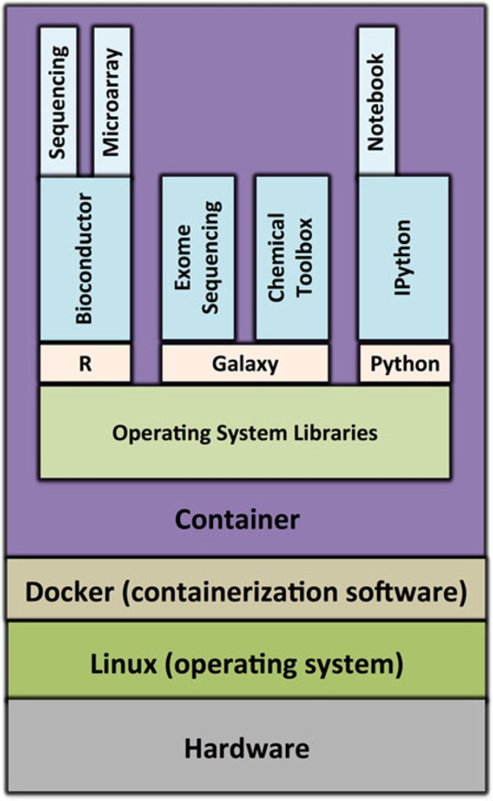
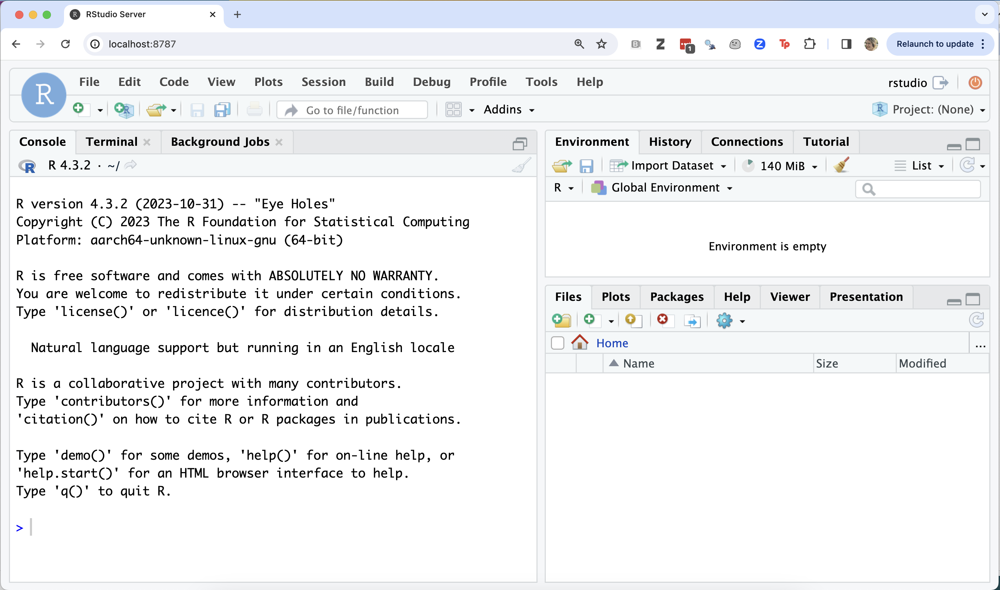
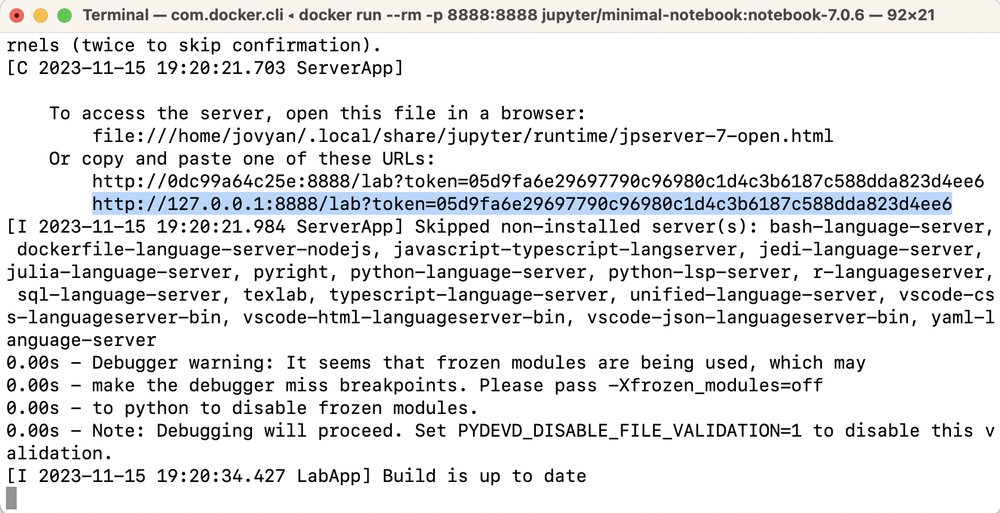
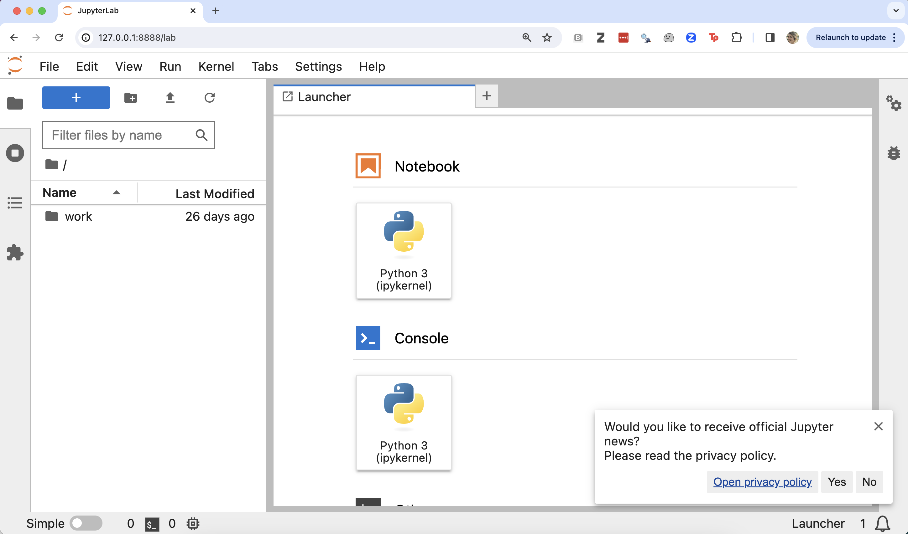
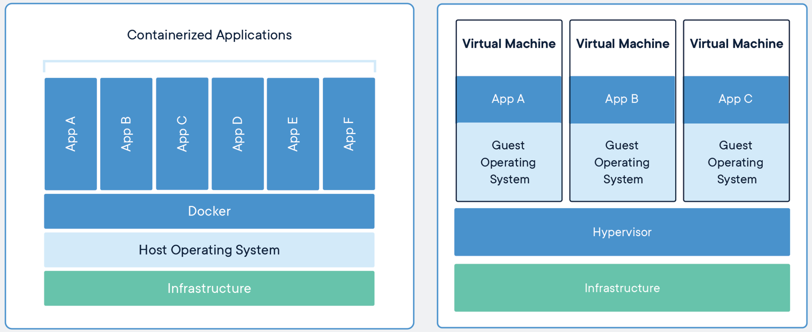
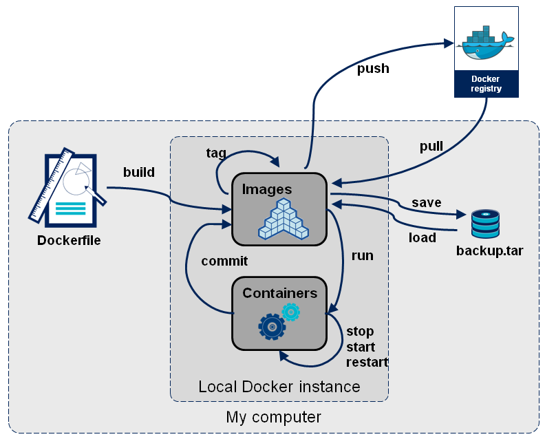
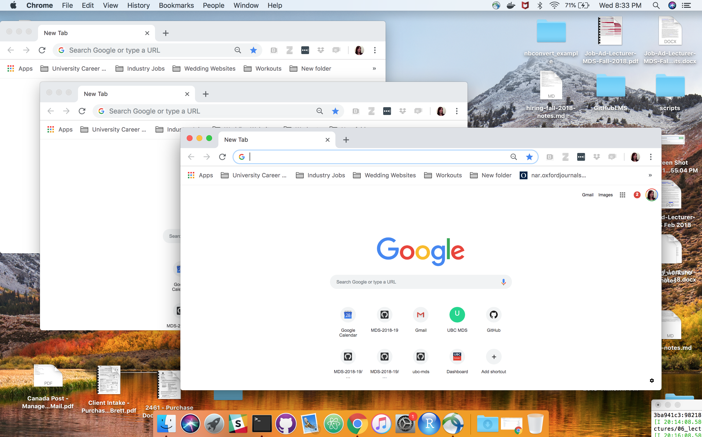

## Learning Objectives {.unnumbered}



## Download the images before you start {.unnumbered}

The exercises in this chapter run three container images,
which together take about 13 GB of disk space (about 3 GB to download).
Downloading them takes a while,
so download (pull) them before you start.
Start Docker first (on macOS and Windows, open Docker Desktop),
then run:

```bash
docker pull rocker/r-ver:4.3.2
docker pull rocker/rstudio:4.4.2
docker pull quay.io/jupyter/datascience-notebook:2025-03-14
```

`docker pull` downloads an image from a container registry without running it.
The Jupyter image is the largest of the three, at about 9 GB.

## Documenting and loading dependencies

You've made some beautiful data analysis pipeline/project
using Make, R, and/or Python.
It runs on your machine, but how easily can you, or someone else,
get it working on theirs?
The answer usually is, it depends...

What does it depend on?

1. Do your `README` and your scripts make it blatantly obvious
   what programming languages and packages are needed
   to run your data analysis pipeline/project?

2. Do you also document the version numbers of the programming languages
   and packages you used?
   This can have big consequences when it comes to reproducibility...
   (*e.g.*, the [change to how `sample()` draws random numbers](https://cran.r-project.org/doc/manuals/r-release/NEWS.3.html) in R 3.6.0, in 2019?)

3. Did you document what other software (beyond the programming languages
   and packages used) and operating system dependencies are needed
   to run your data analysis pipeline/project?

*Virtual environments can be tremendously helpful with #1 & #2;
however, they may or may not be helpful to manage #3...*
__*Enter containerization as a possible solution!*__

## What is a container?

Containers are another way to generate
(and share!) isolated computational environments.
They differ from virtual environments (which we discussed previously)
in that they are even more isolated from the computer's operating system,
and they can be used to share many other types of software,
applications, and operating system dependencies.

Before we can fully define containers, however, we need to define **virtualization**.
Virtualization is a process that allows us
to divide the elements of a single computer into several virtual elements.
These elements can include computer hardware platforms, storage devices,
computer network resources,
and even operating system user spaces (e.g., graphical tools, utilities, and programming languages).

Containers virtualize operating system user spaces
so that they can isolate the processes they contain,
as well as control the processes’ access to computer resources (e.g., CPUs, memory, and disk space).
What this means in practice
is that an operating system user space can be carved up into multiple containers
running the same or different processes in isolation.
Below we show the schematic of a container whose virtual user space contains the:

- R programming language, the Bioconductor package manager,
  and two Bioconductor packages
- Galaxy workflow software and two toolboxes that can be used with it
- Python programming language, IPython interpreter, and Jupyter notebook package



**Schematic of a container for genomics research.**
Source: <https://doi.org/10.1186/s13742-016-0135-4>

:::{.exercise}

**Running a simple container**

To further illustrate what a container looks like, and feels like,
we can use Docker (containerization software) to run one and explore.
First we will run a Linux (Debian-flavored) container that has R installed.
To run this, type:

```bash
docker run --rm -it rocker/r-ver:4.3.2
```

Here is what each part of the command does:

- `docker run` starts a new container from an image.
  If the image is not on your computer yet,
  Docker first downloads (pulls) it from a container registry.
- `--rm` deletes the container when it stops,
  so that stopped containers do not pile up on your computer.
- `-it` is two flags written together.
  `-i` (`--interactive`) keeps the container's input open,
  so that what you type reaches R.
  `-t` (`--tty`) connects R to a terminal,
  so that R runs as an interactive session.
  Without `-t`, R stops with `Fatal error: you must specify '--save', '--no-save' or '--vanilla'`.
- `rocker/r-ver:4.3.2` is the image to run,
  `rocker/r-ver` from Docker Hub with the tag `4.3.2`, which picks R 4.3.2.

:::{.callout-note title="More information"}
R starts because the image's [`Dockerfile`](https://github.com/rocker-org/rocker-versioned2/blob/R4.3.2/dockerfiles/r-ver_4.3.2.Dockerfile)
sets `CMD ["R"]`, the command a container runs when it starts.
[Building images](0630-containers-building.qmd) explains `CMD`.

[Running containers](0620-containers-running.qmd) covers these flags in more detail,
and Docker's [`docker run` reference](https://docs.docker.com/reference/cli/docker/container/run/) lists them all.
:::

When you successfully launch the container, R should have started.
Check the version of R - is it the same as your computer's version of R?
Use `getwd()` and `list.files()` to explore the container's filesystem from R.
Does this look like your computer's filesystem or something else?

Type `q()` to quit R and exit the container.
:::

Compare this version of R that is running in the container
to the version of R you have on your computer.

:::{.exercise}
**Running a container with RStudio as a web app**

Next,
try to use Docker to run a container
that has the RStudio Server web application installed:

```bash
docker run --rm -p 8787:8787 -e PASSWORD="apassword" rocker/rstudio:4.4.2
```

Then open a web browser on your computer and type: <http://localhost:8787>

If it worked, then you should be at an RStudio Sign In page.
To sign in, use the following credentials:

- **username:** rstudio
- **password:** apassword

The RStudio Server web app being run
by the container should look something like this:



Type `Ctrl` + `C` in the terminal where you launched the container to quit R
and RStudio and exit the container.
:::

We can pass in multiple environment variables by using multiple `-e` flags.
For example,
we can set the password for the rstudio user
with the `PASSWORD` environment variable,
but we can also disable the login screen with the `DISABLE_AUTH=true` variable.

```bash
docker run --rm -p 8787:8787 -e PASSWORD="apassword" -e DISABLE_AUTH=true rocker/rstudio:4.4.2
```

Each container will have its own set of environment variables
to control its behavior.
For the `rocker/rstudio` project,
you can find the environment variable documentation here:
<https://rocker-project.org/images/versioned/rstudio.html#environment-variables>.

:::{.exercise}

**Running a container with Jupyter as a web app**

Next,
try to use Docker to run a container
that has the Jupyter web application installed:

```bash
docker run --rm -p 8888:8888 quay.io/jupyter/datascience-notebook:2025-03-14
```

In the terminal,
look for a URL that starts with `http://127.0.0.1:8888/lab?token=`
(for an example, see the highlighted text in the terminal below).
Copy and paste that URL into your browser.

:::{.callout-important}
Do not forget to copy the `token=` portion of the URL.
If you only go to `localhost:8888` or `http://127.0.0.1:8888`,
it will ask you for the password/token.
:::



The Jupyter web application being run
by the container should look something like this:



Type <kbd>Ctrl</kbd> + <kbd>c</kbd> in the terminal where you launched the container
to quit Jupyter and exit the container.
:::

## Contrasting containers with virtual machines

Virtual machines are another technology that can be used to generate
(and share) isolated computational environments.
Virtual machines emulate the functionality of an entire computer
on another physical computer.
With virtual machines, the virtualization occurs at the layer of software
that sits between the computer's hardware and the operating system(s).
This software is called a hypervisor.
For example, on a Mac laptop,
you could install a program called [Oracle VirtualBox](https://www.virtualbox.org/)
to run a virtual machine whose operating system was Windows 8.1,
as the screenshot below shows:


**A screenshot of a macOS computer running a Windows virtual machine.**
Source: <https://www.virtualbox.org/wiki/Screenshots>

Below,
we share an illustration that compares where virtualization happens
in containers compared to virtual machines.
This difference
leads to containers being more lightweight and portable
compared to virtual machines,
and also less isolated.



*Source: <https://www.docker.com/resources/what-container>*


**Key take-home:** Containerization software shares the host's operating system,
whereas virtual machines have a completely separate, additional operating system.
This can make containers lighter (smaller in terms of size)
and more resource- and time-efficient than using a virtual machine.

## Contrasting common computational environment virtualization strategies

| Feature | Virtual environment | Container | Virtual machine |
|---------|---------------------|-----------|-----------------|
| Virtualization level | Application | Operating system user-space | Hardware |
| Isolation | Programming languages, packages | Programming languages, packages, **other software, operating system dependencies, filesystems, networks** | Programming languages, packages, other software, operating system dependencies, filesystems, networks, **operating systems** |
| Size | Extremely lightweight | Lightweight | Heavyweight |

## Virtualization strategy advantages and disadvantages for reproducibility

Let's collaboratively generate a list of advantages
and disadvantages of each virtualization strategy in the context of reproducibility:


### Virtual environment

A virtual environment, such as a uv or renv project,
isolates the packages for one programming language.

#### Advantages
- Extremely small size
- Porous (less isolated) - makes it easy
  to pair the virtualized computational environment with files on your computer
- Specify these with a single text file

#### Disadvantages
- Not always possible to capture and share operating system dependencies,
  and other software your analysis depends upon
- Computational environment is not fully isolated,
  and so missed dependencies can go unnoticed

### Containers

A container isolates an operating system user space,
with its programming languages, packages and other software.

#### Advantages
- Somewhat lightweight in size (manageable for easy sharing - there are tools
  and software to facilitate this)
- Possible to capture and share operating system dependencies,
  and other software your analysis depends upon
- Computational environment is fully isolated,
  and errors will occur if dependencies are missing
- Specify these with a single text file
- Can share volumes and ports (advantage compared to virtual machines)

#### Disadvantages
- Possible security issues - running software on your computer that you may allow
  to be less isolated (i.e., mount volumes, expose ports)
- Takes some effort to share volumes and ports (disadvantage compared
  to virtual environments)

### Virtual machine

A virtual machine isolates a whole computer,
including its operating system.

#### Advantages
- High security, because these are much more isolated (filesystem, ports, etc.)
- Can share an entirely different operating system (might not be so useful
  in the context of reproducibility however...)

#### Disadvantages
- Very big in size, which can make it prohibitive to share them
- Takes great effort to share volumes and ports - which makes it hard to give access
  to data on your computer

## Container usage workflow

Below is a schematic of a typical container usage workflow from a [blog post](https://blog.octo.com/en/docker-registry-first-steps/)
by Arnaud Mazin.
The source code for container images is stored in a file called a `Dockerfile`.
Like a `pyproject.toml` or an `renv.lock` file,
you would typically version control this with Git and store this
in your GitHub repository with your analysis code.
From the source `Dockerfile` we can build a Docker container image.
This image is a binary file, from which we can run one, or more, container instances.
Container instances are the computational environment
in which you would run your analysis.
Containers are usually ephemeral - we create them from the image when we want
to run the analysis and then stop and remove/delete them after it has run.
Docker images can (and should) be versioned and shared via container registries
(which are akin to remote code repositories).



*Source: [OctoTalks](https://blog.octo.com/en/docker-registry-first-steps/)*

## Image vs container?

Analogy: The program Chrome is like a Docker image,
whereas a Chrome window is like a Docker container.



You can list the container **images** on your computer that you pulled
using Docker via `docker images`.
After pulling the images for this chapter,
the list includes these three, and any other images you have:

```bash
docker images
```

```out
IMAGE                                             ID             DISK USAGE   CONTENT SIZE   EXTRA
quay.io/jupyter/datascience-notebook:2025-03-14   bf25d19758c0       9.06GB         2.17GB        
rocker/r-ver:4.3.2                                4e32addfc4da       1.11GB          313MB        
rocker/rstudio:4.4.2                              6bfc87fb66d0       3.16GB          734MB        
```

`DISK USAGE` is how much space an image takes on your computer,
and `CONTENT SIZE` is about how much was downloaded.

You can list the states of containers that have been started by Docker
on your computer (and not yet removed) via `docker ps -a`.
Here, the R container from the first exercise
and the RStudio container from the second are both running:

```bash
docker ps -a
```

```out
CONTAINER ID   IMAGE                  COMMAND   CREATED        STATUS                  PORTS                                         NAMES
adf3ea77f63f   rocker/rstudio:4.4.2   "/init"   1 second ago   Up Less than a second   0.0.0.0:8787->8787/tcp, [::]:8787->8787/tcp   objective_hoover
adca5933388b   rocker/r-ver:4.3.2     "R"       1 second ago   Up Less than a second                                                 hardcore_swartz
```

## What is a container registry?

A container registry is a remote repository, or collection of repositories,
used to share container images.
This is similar to remote version control repositories for sharing code.
Instead of code, however,
it is container images that are pushed and pulled to/from there.
For this course we will focus on the widely used Docker Hub container registry:
<https://hub.docker.com/>.

However, there are many container registries that can be used, including:

- <https://github.com/>
- <https://quay.io/>
- <https://aws.amazon.com/ecr/>

In the examples above, we have used the `rocker/rstudio` container,
which comes from Docker Hub,
and the Jupyter server comes from `quay.io`.

:::{.exercise}

**Exploring container registries**

Let's visit the repositories for the two container images that we used
in the exercise earlier in class:

- [rocker/rstudio](https://hub.docker.com/r/rocker/rstudio)
- [quay.io/jupyter/datascience-notebook](https://quay.io/repository/jupyter/datascience-notebook?tab=tags)

Question: you pulled these images with `docker pull` before you started.
What would `docker run ...` have done if you had not?

Answer: `docker run ...` will first look for images you have locally,
and run those if they exist.
If they do not exist, it then attempts to pull the image
from the registry named in the image
(Docker Hub, if the image name does not name a registry).
:::
