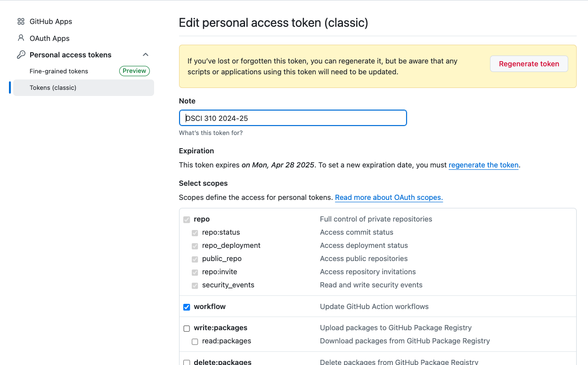

## Learning Objectives {.unnumbered}



## Download the images before you start {.unnumbered}

The examples in this chapter build on `rocker/r-ver:4.6.2`,
which takes more than a gigabyte of disk space.
Start Docker first (on macOS and Windows, open Docker Desktop),
then download (pull) it before you start:

```bash
docker pull rocker/r-ver:4.6.2
```

## Building container images from `Dockerfile`'s

- A `Dockerfile` is a plain-text file
  that contains commands primarily about what software to install
  in the Docker image.
  This is the more trusted and transparent way to build Docker images.

- Once we have created a `Dockerfile`, we can build it into a Docker image.

- Docker images are built in layers, and as such,
  `Dockerfile`s always start by specifying a base Docker image that the new image
  is to be built on top of.

- Docker containers are all Linux containers and thus use Linux commands
  to install software.
  However, there are different flavors of Linux
  (e.g., Ubuntu, Debian, CentOS, Red Hat),
  and thus you need to use the right Linux install commands
  to match your flavor of container.
  For this course, we will focus on Ubuntu- or Debian-based images (and that means
  if we need to install software outside of R and Python packages,
  we will use `apt-get` as our installation program).
  However, most of what we'll be doing for installation is R,
  Python, and their packages.
  For those, an image uses the same tools as your laptop,
  uv for Python and renv for R,
  which the next chapters put into an image.

:::{.callout-note title="`apt` or `apt-get`?"}
Ubuntu has two commands for its package manager.
`apt` is designed for people typing at a terminal,
and its behavior may change between versions.
`apt-get` is the older command, which keeps working the same way,
so Ubuntu's [`apt` manual page](https://manpages.ubuntu.com/manpages/noble/man8/apt.8.html)
recommends `apt-get` for scripts.
The `RUN` lines in a `Dockerfile` are a script,
so this book uses `apt-get` in them.
`apt` even prints a warning when a script runs it:

```out
WARNING: apt does not have a stable CLI interface. Use with caution in scripts.
```

At a container's prompt either command works,
but using `apt-get` there too
means you can copy the command that worked straight into the `Dockerfile`.
:::


### Workflow for building a Dockerfile

It can take a LOOOOOOOONNNG time to troubleshoot the building of Docker images.
Thus, to speed things up and be more efficient, we suggest the workflow below:

1. Choose a base image to build off (from <https://hub.docker.com/>).

2. Create a `Dockerfile` named `Dockerfile` and save
   it in an appropriate project repository.
   Open that file and type `FROM <BASE_IMAGE>` on the first line.
   Add any files that need to be accessed at build time via the `COPY` command.

3. In a terminal,
   type `docker run --rm -it <BASE_IMAGE> bash`
   and interactively try the install commands you think will work.
   Edit and try again until the install command works.
   The `bash` at the end starts a Bash shell
   in place of the image's default command.

4. Write working install commands in the `Dockerfile`,
   preceding them with `RUN`, and save the `Dockerfile`.

5. After adding every 2–3 commands to your `Dockerfile`,
   try building the Docker image via `docker build --tag <TEMP_IMAGE_NAME> <PATH_TO_DOCKERFILE_DIRECTORY>`.

6. Once the entire `Dockerfile` works from beginning to end on your laptop,
   then you can finally move to building remotely (e.g., creating a trusted build
   on GitHub Actions).

### Build your first image

Let's follow the workflow to build a small image with R
and the R package [cowsay](https://cran.r-project.org/package=cowsay),
which draws an animal saying whatever you give it.

For step 1, the base image is `rocker/r-ver:4.6.2`, Ubuntu Linux with R 4.6.2 installed.
For step 2, make a folder for the project and move into it:

```bash
mkdir hello-cowsay
cd hello-cowsay
```

In a text editor, create a file in that folder named `Dockerfile`,
with no file extension,
that has one line:

```{.dockerfile}
FROM rocker/r-ver:4.6.2
```

For step 3, start a container from the base image with a Bash shell:

```bash
docker run --rm -it rocker/r-ver:4.6.2 bash
```

Inside R, you would install the package with `install.packages("cowsay")`.
At the container's Bash prompt,
`Rscript -e` runs a line of R code instead,
which is the form a `RUN` line needs:

```bash
Rscript -e "install.packages('cowsay')"
```

```out
Installing package into ‘/usr/local/lib/R/site-library’
(as ‘lib’ is unspecified)
also installing the dependencies ‘crayon’, ‘rlang’

trying URL 'https://p3m.dev/cran/__linux__/resolute/latest/src/contrib/crayon_1.5.3.tar.gz'
trying URL 'https://p3m.dev/cran/__linux__/resolute/latest/src/contrib/rlang_1.3.0.tar.gz'
trying URL 'https://p3m.dev/cran/__linux__/resolute/latest/src/contrib/cowsay_1.2.2.tar.gz'
* installing *binary* package ‘crayon’ ...
* package ‘crayon’ successfully unpacked and SHA256 sums checked
* DONE (crayon)
* installing *binary* package ‘rlang’ ...
* package ‘rlang’ successfully unpacked and SHA256 sums checked
* DONE (rlang)
* installing *binary* package ‘cowsay’ ...
* package ‘cowsay’ successfully unpacked and SHA256 sums checked
* DONE (cowsay)

The downloaded source packages are in
	‘/tmp/RtmpAypckK/downloaded_packages’
```

Then try it:

```bash
Rscript -e "cowsay::say('Hello')"
```

```out
 _______ 
< Hello >
 ------- 
      \
       \

        ^__^ 
        (oo)\ ________ 
        (__)\         )\ /\ 
             ||------w|
             ||      ||
```

Type `exit` to leave the container.

For step 4, write the commands that worked into the `Dockerfile`:

```{.dockerfile}
FROM rocker/r-ver:4.6.2

RUN Rscript -e "install.packages('cowsay')"

CMD ["Rscript", "-e", "cowsay::say('Hello from my first image!')"]
```

`RUN` runs the install while the image is built.
It is the same command you typed at the container's Bash prompt,
which is one reason this book works at the command line
(see [Introduction to the Bash Shell](0120-bash-shell.qmd)).
`CMD` sets the command a container from this image runs when it starts.
It replaces the base image's own `CMD ["R"]`
(see [Introduction to containerization](0610-containers.qmd)),
so a container runs our line of R code instead of starting R.

:::{.callout-warning title="A misspelled package does not stop the build"}
`install.packages()` only warns when it cannot find a package,
and `Rscript` still finishes with exit status `0`,
which tells the shell that the command worked.
`echo $?` prints the exit status of the last command:

```bash
Rscript -e "install.packages('cowsya')"
echo $?
```

```out
Installing package into ‘/usr/local/lib/R/site-library’
(as ‘lib’ is unspecified)
Warning message:
package ‘cowsya’ is not available for this version of R

A version of this package for your version of R might be available elsewhere,
see the ideas at
https://cran.r-project.org/doc/manuals/r-patched/R-admin.html#Installing-packages 
0
```

So a `RUN` line with a misspelled package builds without an error,
into an image without the package.
Adding `library()` after the install makes R stop with an error,
which stops the build at that step:

```bash
Rscript -e "install.packages('cowsya'); library(cowsya)"
echo $?
```

```out
Installing package into ‘/usr/local/lib/R/site-library’
(as ‘lib’ is unspecified)
Warning message:
package ‘cowsya’ is not available for this version of R

A version of this package for your version of R might be available elsewhere,
see the ideas at
https://cran.r-project.org/doc/manuals/r-patched/R-admin.html#Installing-packages 
Error in library(cowsya) : there is no package called ‘cowsya’
Execution halted
1
```
:::

For step 5, build the image from the folder that has the `Dockerfile`:

```bash
docker build --tag hello-cowsay .
```

- `--tag hello-cowsay` names the image.
  You can add a version after a colon, such as `hello-cowsay:0.1`;
  without one, Docker uses the tag `latest`.
- `.` is the build context,
  the folder Docker reads the `Dockerfile` and any copied files from,
  here the current folder.

```out
[+] Building 4.0s (6/6) FINISHED                                               docker:desktop-linux
 => [internal] load build definition from Dockerfile                                           0.0s
 => => transferring dockerfile: 176B                                                           0.0s
 => [internal] load metadata for docker.io/rocker/r-ver:4.6.2                                  0.0s
 => [internal] load .dockerignore                                                              0.0s
 => => transferring context: 2B                                                                0.0s
 => CACHED [1/2] FROM docker.io/rocker/r-ver:4.6.2@sha256:8739c76d2d9316698a7145b032601f1e822  0.0s
 => => resolve docker.io/rocker/r-ver:4.6.2@sha256:8739c76d2d9316698a7145b032601f1e82249fdee3  0.0s
 => [2/2] RUN Rscript -e "install.packages('cowsay')"                                          3.6s
 => exporting to image                                                                         0.2s
 => => exporting layers                                                                        0.1s
 => => exporting manifest sha256:3194becb32301ec3fcd846472866f8501aa5035f582f5149e2714b6d4903  0.0s
 => => exporting config sha256:c6f87af4eb6e98b553b3ee935b571ec906888a174f9322e359e9b96e2b15c1  0.0s
 => => exporting attestation manifest sha256:8b4f5f3c8233fa3a54471ca2fe6f7471a873845c8477c3c6  0.0s
 => => exporting manifest list sha256:9f2606d682dc224d8df0cdb02909dabdbfd7e4218aa98cd8cace121  0.0s
 => => naming to docker.io/library/hello-cowsay:latest                                         0.0s
 => => unpacking to docker.io/library/hello-cowsay:latest                                      0.1s
```

Each `[1/2]` and `[2/2]` is a step of the `Dockerfile`.
If you have not pulled `rocker/r-ver:4.6.2` before,
the `FROM` step downloads it first.

Run a container from the new image.
It needs no `-it`,
because our R code prints its message and exits:

```bash
docker run --rm hello-cowsay
```

```out
 ____________________________ 
< Hello from my first image! >
 ---------------------------- 
      \
       \

        ^__^ 
        (oo)\ ________ 
        (__)\         )\ /\ 
             ||------w|
             ||      ||
```

### Layer caching

Docker saves each step's result as a layer,
and reuses a layer when nothing in its step, or in the steps above it, has changed.
To see this, change only the message on the `CMD` line of the `Dockerfile`:

```{.dockerfile}
CMD ["Rscript", "-e", "cowsay::say('Moo! Only my message changed.')"]
```

Then build again:

```bash
docker build --tag hello-cowsay .
```

```out
[+] Building 0.2s (6/6) FINISHED                                               docker:desktop-linux
 => [internal] load build definition from Dockerfile                                           0.0s
 => => transferring dockerfile: 179B                                                           0.0s
 => [internal] load metadata for docker.io/rocker/r-ver:4.6.2                                  0.0s
 => [internal] load .dockerignore                                                              0.0s
 => => transferring context: 2B                                                                0.0s
 => [1/2] FROM docker.io/rocker/r-ver:4.6.2@sha256:8739c76d2d9316698a7145b032601f1e82249fdee3  0.0s
 => => resolve docker.io/rocker/r-ver:4.6.2@sha256:8739c76d2d9316698a7145b032601f1e82249fdee3  0.0s
 => CACHED [2/2] RUN Rscript -e "install.packages('cowsay')"                                   0.0s
 => exporting to image                                                                         0.1s
 => => exporting layers                                                                        0.0s
 => => exporting manifest sha256:f2d1c5ab15c8048a1863f62aa572f3bc2c971015fe8a2c04c5a4f1123137  0.0s
 => => exporting config sha256:0146dc6311dfcf1595b66373383e7f7bc1b4f0deae336219d9487b03da6d38  0.0s
 => => exporting attestation manifest sha256:bc8aca2ce37900fcdcd01fda5fed9286c997df019e23c971  0.0s
 => => exporting manifest list sha256:168f3c35f574628804baaf63e71be4164a7d1534ca35229a6827c7c  0.0s
 => => naming to docker.io/library/hello-cowsay:latest                                         0.0s
 => => unpacking to docker.io/library/hello-cowsay:latest                                      0.0s
```

The `RUN` step says `CACHED`.
Docker reused the layer with cowsay installed
and only changed the default command:

```bash
docker run --rm hello-cowsay
```

```out
 _______________________________ 
< Moo! Only my message changed. >
 ------------------------------- 
      \
       \

        ^__^ 
        (oo)\ ________ 
        (__)\         )\ /\ 
             ||------w|
             ||      ||
```

Installing one package took a few seconds,
but installing many packages, or packages that R compiles from source,
can take many minutes, and the cache skips all of it.
This is why a `Dockerfile` puts the steps that change least often,
such as installing software, near the top,
and the steps that change most often near the bottom.
A change to one step rebuilds that step and every step below it.

`docker image ls` lists the image,
and `docker history` lists its layers, newest first
(`head -5` keeps the first five lines):

```bash
docker image ls hello-cowsay
```

```out
IMAGE                 ID             DISK USAGE   CONTENT SIZE   EXTRA
hello-cowsay:latest   168f3c35f574       1.45GB          390MB        
```

```bash
docker history hello-cowsay | head -5
```

```out
IMAGE          CREATED          CREATED BY                                      SIZE      COMMENT
168f3c35f574   17 seconds ago   CMD ["Rscript" "-e" "cowsay::say('Moo! Only …   0B        buildkit.dockerfile.v0
<missing>      17 seconds ago   RUN /bin/sh -c Rscript -e "install.packages(…   4.17MB    buildkit.dockerfile.v0
<missing>      11 days ago      COPY scripts /rocker_scripts # buildkit         168kB     buildkit.dockerfile.v0
<missing>      11 days ago      CMD ["R"]                                       0B        buildkit.dockerfile.v0
```

The top two rows are the layers our `Dockerfile` added.
The `RUN` layer holds the 4.17MB of R packages,
and it shows that Docker ran the command with `/bin/sh -c`.
The `CMD` layer adds no files, only the default command, so its size is 0B.
The rows below come from `rocker/r-ver:4.6.2`,
including its `CMD ["R"]`, which our `CMD` replaces.

:::{.callout-note title="More information"}
Docker runs `RUN` commands with the shell `/bin/sh`, not Bash,
unless the `Dockerfile` picks another shell with the `SHELL` instruction
(see Docker's [`Dockerfile` reference](https://docs.docker.com/reference/dockerfile/)).
For commands like these, the two shells behave the same.
:::

### Guidelines for `RUN` commands

Each `RUN` command creates a new layer in the Docker image.
Each layer in a Docker image takes more disk space.
As a consequence, we want to minimize the number of layers where reasonably possible.
How can we do this?

Install everything that can be installed by a tool
(e.g., `apt-get`, or `install.packages()` in R) at once
(i.e., when installing 5 programs via `apt-get`,
do not call `apt-get` five times;
instead do: `apt-get install tool1 tool2 tool3 tool4 tool5`,
and in R, `install.packages(c("pkg1", "pkg2"))`).
However, doing this can lead to long lines.
In response,
we can break a single command across lines in the shell by using the `\` character.
For example,
to reduce the long line below, which uses `apt-get` to install the programs Git,
Tiny Nano, Less, and wget:

```bash
apt-get install --yes git nano-tiny less wget
```

We can use `\` after each program
to break the long command across lines and make the command more readable (especially
if there were even more programs to install).
Similarly, we indent the lines after `\` to increase readability:

```bash
apt-get install --yes \
    git \
    nano-tiny \
    less \
    wget
```

We can also group together related commands that depend upon each other.
When doing this, we need to be careful, though,
as sometimes we don't want to run a command if the command that was run immediately
before it failed.
We can specify this in the shell using `&&`.
For example,
if we want to not run `apt-get` installation commands if `apt-get update` failed,
we can write:

```bash
apt-get update && \
    apt-get install --yes git
```

## `Dockerfile` command summary

The most common `Dockerfile` commands I use:

| Command | Description |
|---------|-------------|
| FROM    | States which base image the new Docker image should be built on top of |
| RUN     | Specifies that a command should be run in a shell |
| ENV | Sets environment variables |
| EXPOSE | Specifies the port the container should listen to at runtime |
| COPY or ADD | Adds files (or URLs in the case of ADD) to a container's filesystem |
| ENTRYPOINT | Configures a container that will run as an executable |
| WORKDIR | Sets the working directory for any `RUN`, `CMD`, `ENTRYPOINT`, COPY and ADD instructions that follow it in the `Dockerfile` |

And more here in the [Dockerfile reference](https://docs.docker.com/engine/reference/builder/).

## Choosing a base image for your Dockerfile


Source:
<https://themuslimtimes.info/2018/10/25/if-i-have-seen-further-it-is-by-standing-on-the-shoulders-of-giants/>

### Good base images to work from for R or Python projects!

| Image | Software installed |
|-------|--------------------|
| [quay.io/repository/jupyter/datascience-notebook](https://jupyter-docker-stacks.readthedocs.io/en/latest/using/selecting.html#jupyter-datascience-notebook) | Includes popular packages from the scientific Python ecosystem. |
| [rocker/rstudio](https://hub.docker.com/r/rocker/rstudio/) | R, RStudio |
| [rocker/tidyverse](https://hub.docker.com/r/rocker/tidyverse/) | R, R packages (including the tidyverse), RStudio, Make; ARM-based computers need tag `4.5.1` or later |
| [condaforge/miniforge3](https://hub.docker.com/r/condaforge/miniforge3) | Miniforge3 base installation |

## Dockerfile FAQ

#### 1. Where does the `Dockerfile` live?

The `Dockerfile` should live in the root directory of your project.

#### 2. How do I make an image from a `Dockerfile`?

There are 2 ways to do this!
I use the first when developing my `Dockerfile` (to test quickly that it works),
and then the second I use when I think I am "done" and want to have it archived
on [Docker Hub](https://hub.docker.com/).

1. Build a Docker image locally on your laptop

2. Build a Docker image and push it to Docker Hub using GitHub Actions

#### 3. How do I build an image locally on my laptop?

From the directory that contains your `Dockerfile` (usually your project root):

```bash
docker build --tag IMAGE_NAME:VERSION .
```

:::{.callout-note}
`--tag` lets you name and version the Docker image.
You can call this anything you want.
The version number/name comes after the colon.
:::

After I build, I then try to `docker run ...` to test the image locally.
If I don't like it, or it doesn't work,
I delete the image with `docker rmi {IMAGE_NAME}`,
edit my Dockerfile, and try to build and run it again.

## Build a Docker image from a Dockerfile on GitHub Actions

Building a Docker image from a `Dockerfile` using an automated tool (e.g., Docker Hub
or GitHub Actions) lets others trust your image as they can clearly see
which `Dockerfile` was used to build which image.

We will do this in this course by using GitHub Actions
(a continuous integration tool)
because it provides a great deal of nuanced control over
when to trigger the automated builds of the Docker image,
and how to tag them.

An example GitHub repository that uses GitHub Actions to build a Docker image
from a `Dockerfile` and publish it on Docker Hub is available here:
<https://github.com/ttimbers/dsci522-dockerfile-practice>

What is there that we haven't already seen here?
It's the GitHub Actions workflow file `.github/workflows/docker-publish.yml` shown below.
This workflow can be triggered manually,
or automatically when a push to GitHub is made that changes the `Dockerfile`
or `conda-linux-64.lock`.
When that happens,
a computer on GitHub will copy the contents of the GitHub repository and build
and version/tag a Docker image using the `Dockerfile` contained therein.
The image will get two tags:
`latest` and the short GitHub SHA corresponding
to the Git commit SHA at the HEAD of `main`.
It will also push the Docker image to Docker Hub.
For that last step to happen,
the code owner's Docker Hub credentials must be stored in the GitHub repository
as [GitHub repository secrets](https://docs.github.com/en/actions/security-for-github-actions/security-guides/using-secrets-in-github-actions).

Example `.github/workflows/docker-publish.yml` file:

```yaml
# Publishes docker image, pinning actions to a commit SHA,
# and updating most recently built image with the latest tag.
# Can be triggered by either pushing a commit that changes the `Dockerfile`,
# or manually dispatching the workflow.

name: Publish Docker image

on:
  workflow_dispatch:
  push:
    paths:
      - 'Dockerfile'
      - .github/workflows/docker-publish.yml # or whatever you named the file
      - 'conda-linux-64.lock'

jobs:
  push_to_registry:
    name: Push Docker image to Docker Hub
    runs-on: ubuntu-latest
    steps:
      - name: Check out the repo
        uses: actions/checkout@v4

      - name: Log in to Docker Hub
        uses: docker/login-action@v3
        with:
          username: ${{ secrets.DOCKER_USERNAME }} # do not change, add as secret
          password: ${{ secrets.DOCKER_PASSWORD }} # do not change, add as secret

      - name: Extract metadata (tags, labels) for Docker
        id: meta
        uses: docker/metadata-action@v5
        with:
          images: ttimbers/dsci522-dockerfile-practice # change to your image
          tags: |
            type=raw, value={{sha}},enable=${{github.ref_type != 'tag' }}
            type=raw, value=latest

      - name: Build and push Docker image
        uses: docker/build-push-action@v6
        with:
          context: .
          file: ./Dockerfile
          push: true
          tags: ${{ steps.meta.outputs.tags }}
          labels: ${{ steps.meta.outputs.labels }}
```

If you are creating this workflow file locally and try to push the file
to your repository,
you may run into an error that mentions your current PAT does not have permissions
to push workflow files.

Go to (account) Settings > Developer Settings > Personal Access Token > Find
and select your PAT,
and then make sure the "Workflow" permission is selected.


