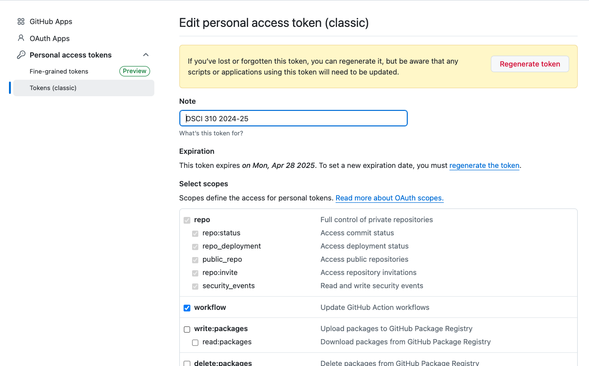

## Learning Objectives {.unnumbered}



## Building container images from `Dockerfile`'s

- A `Dockerfile` is a plain-text file
  that contains commands primarily about what software to install
  in the Docker image.
  This is the more trusted and transparent way to build Docker images.

- Once we have created a `Dockerfile`, we can build it into a Docker image.

- Docker images are built in layers, and as such,
  `Dockerfile`s always start by specifying a base Docker image that the new image
  is to be built on top of.

- Docker containers are all Linux containers and thus use Linux commands
  to install software.
  However, there are different flavors of Linux
  (e.g., Ubuntu, Debian, CentOS, Red Hat),
  and thus you need to use the right Linux install commands
  to match your flavor of container.
  For this course, we will focus on Ubuntu- or Debian-based images (and that means
  if we need to install software outside of R and Python packages,
  we will use `apt` as our installation program).
  However, most of what we'll be doing for installation is R,
  Python, and their packages.
  For that, we can really use tools we're already familiar with (`conda`
  and `conda-lock`,
  for example).


### Workflow for building a Dockerfile

It can take a LOOOOOOOONNNG time to troubleshoot the building of Docker images.
Thus, to speed things up and be more efficient, we suggest the workflow below:

1. Choose a base image to build off (from <https://hub.docker.com/>).

2. Create a `Dockerfile` named `Dockerfile` and save
   it in an appropriate project repository.
   Open that file and type `FROM <BASE_IMAGE>` on the first line.
   Add any files that need to be accessed at build time via the `COPY` command.

3. In a terminal,
   type `docker run --rm -it <IMAGE_NAME>`
   and interactively try the install commands you think will work.
   Edit and try again until the install command works.

4. Write working install commands in the `Dockerfile`,
   preceding them with `RUN`, and save the `Dockerfile`.

5. After adding every 2–3 commands to your `Dockerfile`,
   try building the Docker image via `docker build --tag <TEMP_IMAGE_NAME> <PATH_TO_DOCKERFILE_DIRECTORY>`.

6. Once the entire `Dockerfile` works from beginning to end on your laptop,
   then you can finally move to building remotely (e.g., creating a trusted build
   on GitHub Actions).

### Guidelines for `RUN` commands

Each `RUN` command creates a new layer in the Docker image.
Each layer in a Docker image takes more disk space.
As a consequence, we want to minimize the number of layers where reasonably possible.
How can we do this?

Install everything that can be installed by a tool
(e.g., `conda`, `mamba`, `pip`, `apt`) at once
(i.e., when installing 5 programs via `apt`,
do not call `apt` five times;
instead do: `apt install tool1 tool2 tool3 tool4 tool5`).
However, doing this can lead to long lines.
In response,
we can break a single command across lines in the shell by using the `\` character.
For example,
to reduce the long line below, which uses `apt` to install the programs Git,
Tiny Nano, Less, and wget:

```bash
apt install --yes git nano-tiny less wget
```

We can use `\` after each program
to break the long command across lines and make the command more readable (especially
if there were even more programs to install).
Similarly, we indent the lines after `\` to increase readability:

```bash
apt install --yes \
    git \
    nano-tiny \
    less \
    wget
```

We can also group together related commands that depend upon each other.
When doing this, we need to be careful, though,
as sometimes we don't want to run a command if the command that was run immediately
before it failed.
We can specify this in the shell using `&&`.
For example,
if we want to not run `apt` installation commands if `apt update` failed,
we can write:

```bash
apt update && \
    apt install --yes git
```

## `Dockerfile` command summary

The most common `Dockerfile` commands I use:

| Command | Description |
|---------|-------------|
| FROM    | States which base image the new Docker image should be built on top of |
| RUN     | Specifies that a command should be run in a shell |
| ENV | Sets environment variables |
| EXPOSE | Specifies the port the container should listen to at runtime |
| COPY or ADD | Adds files (or URLs in the case of ADD) to a container's filesystem |
| ENTRYPOINT | Configures a container that will run as an executable |
| WORKDIR | Sets the working directory for any `RUN`, `CMD`, `ENTRYPOINT`, COPY and ADD instructions that follow it in the `Dockerfile` |

And more here in the [Dockerfile reference](https://docs.docker.com/engine/reference/builder/).

## Choosing a base image for your Dockerfile


Source:
<https://themuslimtimes.info/2018/10/25/if-i-have-seen-further-it-is-by-standing-on-the-shoulders-of-giants/>

### Good base images to work from for R or Python projects!

| Image | Software installed |
|-------|--------------------|
| [quay.io/repository/jupyter/datascience-notebook](https://jupyter-docker-stacks.readthedocs.io/en/latest/using/selecting.html#jupyter-datascience-notebook) | Includes popular packages from the scientific Python ecosystem. |
| [rocker/rstudio](https://hub.docker.com/r/rocker/rstudio/) | R, RStudio |
| [rocker/tidyverse](https://hub.docker.com/r/rocker/tidyverse/) | R, R packages (including the tidyverse), RStudio, Make; ARM-based computers need tag `4.5.1` or later |
| [condaforge/miniforge3](https://hub.docker.com/r/condaforge/miniforge3) | Miniforge3 base installation |

## Dockerfile FAQ

#### 1. Where does the `Dockerfile` live?

The `Dockerfile` should live in the root directory of your project.

#### 2. How do I make an image from a `Dockerfile`?

There are 2 ways to do this!
I use the first when developing my `Dockerfile` (to test quickly that it works),
and then the second I use when I think I am "done" and want to have it archived
on [Docker Hub](https://hub.docker.com/).

1. Build a Docker image locally on your laptop

2. Build a Docker image and push it to Docker Hub using GitHub Actions

#### 3. How do I build an image locally on my laptop?

From the directory that contains your `Dockerfile` (usually your project root):

```bash
docker build --tag IMAGE_NAME:VERSION .
```

:::{.callout-note}
`--tag` lets you name and version the Docker image.
You can call this anything you want.
The version number/name comes after the colon.
:::

After I build, I then try to `docker run ...` to test the image locally.
If I don't like it, or it doesn't work,
I delete the image with `docker rmi {IMAGE_NAME}`,
edit my Dockerfile, and try to build and run it again.

## Build a Docker image from a Dockerfile on GitHub Actions

Building a Docker image from a `Dockerfile` using an automated tool (e.g., Docker Hub
or GitHub Actions) lets others trust your image as they can clearly see
which `Dockerfile` was used to build which image.

We will do this in this course by using GitHub Actions
(a continuous integration tool)
because it provides a great deal of nuanced control over
when to trigger the automated builds of the Docker image,
and how to tag them.

An example GitHub repository that uses GitHub Actions to build a Docker image
from a `Dockerfile` and publish it on Docker Hub is available here:
<https://github.com/ttimbers/dsci522-dockerfile-practice>

What is there that we haven't already seen here?
It's the GitHub Actions workflow file `.github/workflows/docker-publish.yml` shown below.
This workflow can be triggered manually,
or automatically when a push to GitHub is made that changes the `Dockerfile`
or `conda-linux-64.lock`.
When that happens,
a computer on GitHub will copy the contents of the GitHub repository and build
and version/tag a Docker image using the `Dockerfile` contained therein.
The image will get two tags:
`latest` and the short GitHub SHA corresponding
to the Git commit SHA at the HEAD of `main`.
It will also push the Docker image to Docker Hub.
For that last step to happen,
the code owner's Docker Hub credentials must be stored in the GitHub repository
as [GitHub repository secrets](https://docs.github.com/en/actions/security-for-github-actions/security-guides/using-secrets-in-github-actions).

Example `.github/workflows/docker-publish.yml` file:

```yaml
# Publishes docker image, pinning actions to a commit SHA,
# and updating most recently built image with the latest tag.
# Can be triggered by either pushing a commit that changes the `Dockerfile`,
# or manually dispatching the workflow.

name: Publish Docker image

on:
  workflow_dispatch:
  push:
    paths:
      - 'Dockerfile'
      - .github/workflows/docker-publish.yml # or whatever you named the file
      - 'conda-linux-64.lock'

jobs:
  push_to_registry:
    name: Push Docker image to Docker Hub
    runs-on: ubuntu-latest
    steps:
      - name: Check out the repo
        uses: actions/checkout@v4

      - name: Log in to Docker Hub
        uses: docker/login-action@v3
        with:
          username: ${{ secrets.DOCKER_USERNAME }} # do not change, add as secret
          password: ${{ secrets.DOCKER_PASSWORD }} # do not change, add as secret

      - name: Extract metadata (tags, labels) for Docker
        id: meta
        uses: docker/metadata-action@v5
        with:
          images: ttimbers/dsci522-dockerfile-practice # change to your image
          tags: |
            type=raw, value={{sha}},enable=${{github.ref_type != 'tag' }}
            type=raw, value=latest

      - name: Build and push Docker image
        uses: docker/build-push-action@v6
        with:
          context: .
          file: ./Dockerfile
          push: true
          tags: ${{ steps.meta.outputs.tags }}
          labels: ${{ steps.meta.outputs.labels }}
```

If you are creating this workflow file locally and try to push the file
to your repository,
you may run into an error that mentions your current PAT does not have permissions
to push workflow files.

Go to (account) Settings > Developer Settings > Personal Access Token > Find
and select your PAT,
and then make sure the "Workflow" permission is selected.


