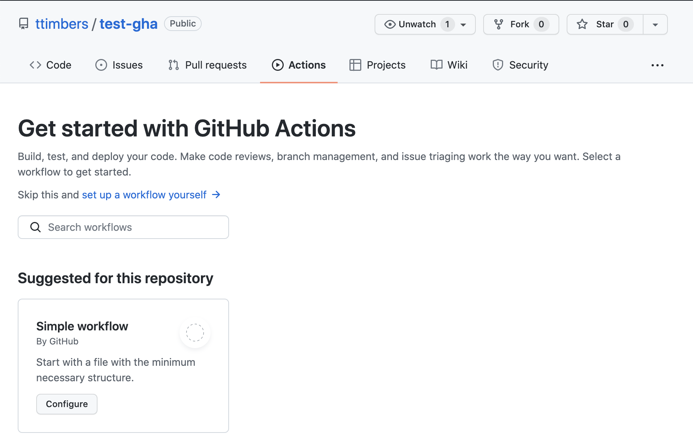
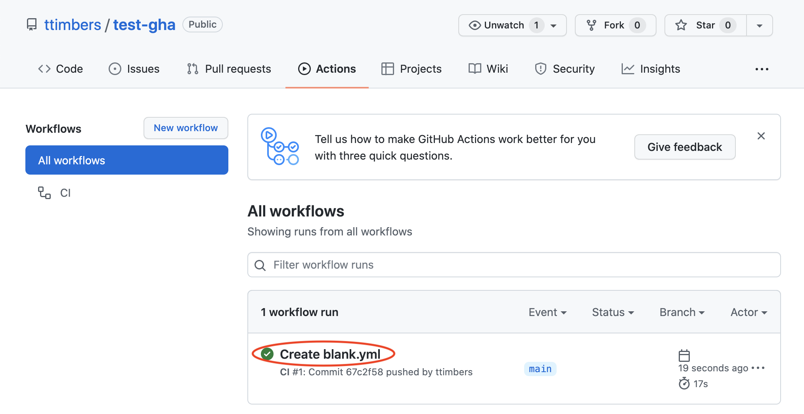
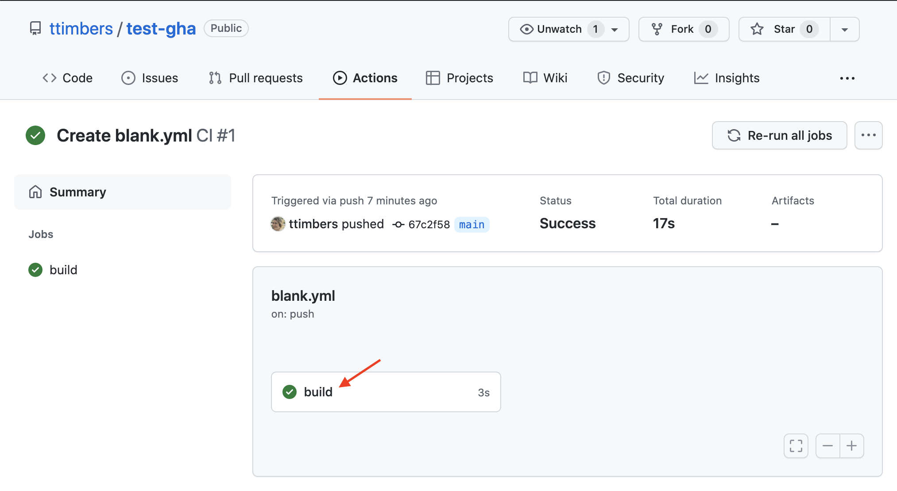
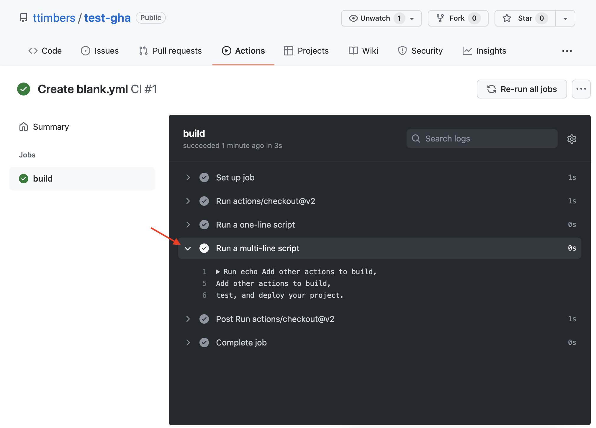
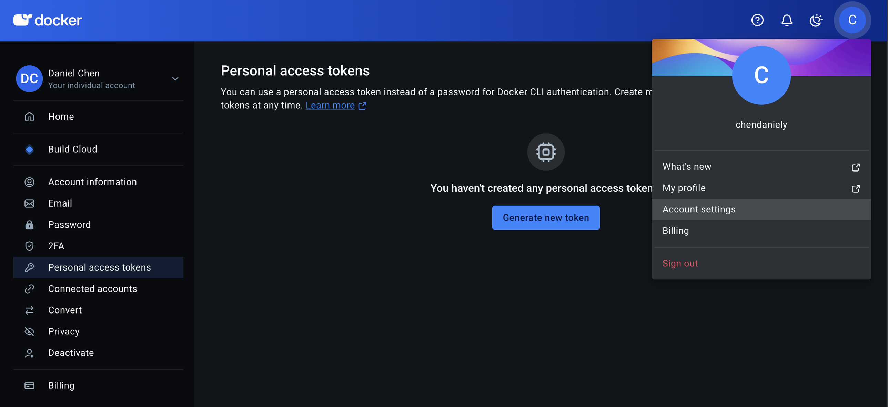
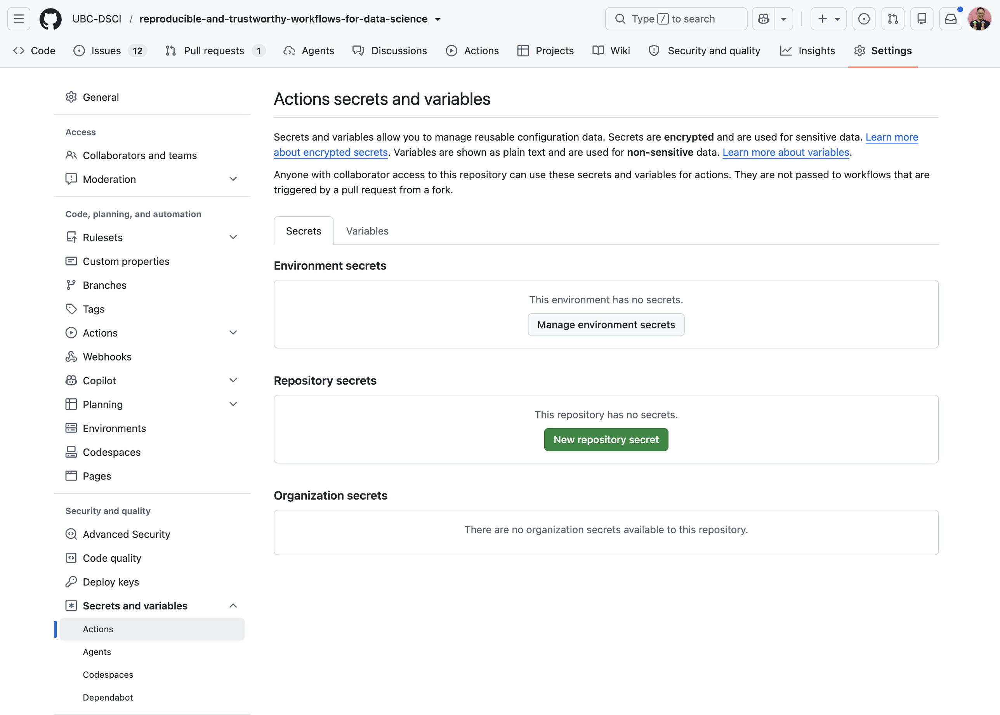

## GitHub Actions

A tool and service for automating software development tasks,
located in the same place where you already store your code.

### Key concepts
**Actions:** Individual tasks you want to perform.

**Workflow:** A collection of actions (specified together in one file).

**Event:** Something that triggers the running of a workflow.

**Runner**: A machine that can run the GitHub Action(s).

**Job**: A set of steps executed on the same runner.

**Step**: A set of commands or actions which a job executes.

### Examples of GitHub Actions

You have already interacted with GitHub Actions in this class!
We used it to:

1. Generate the issues in the [`dsci-310-homework` repo](https://github.com/UBC-DSCI/dsci-310-homework) upon push to the "create" branch: <https://github.com/UBC-DSCI/dsci-310-homework/blob/master/.github/workflows/create_issues.yml>

2. Generate a pull request in the [`review-my-pull-request` repo](https://github.com/ttimbers/review-my-pull-request)
   upon push to the "pr" branch: <https://github.com/ttimbers/review-my-pull-request/blob/master/.github/workflows/pr.yml>

:::{.exercise}
Getting to know GitHub Actions workflows

We are going to each create our own GitHub Actions workflow.
This workflow is a very simple toy example
where we run some `echo` shell commands to print things to the runner's terminal.

#### Steps

1. Create a new public **GitHub.com** repository with a `README`.

2. Click on the "Actions" tab.

3. Click on the first "Set up this workflow" button.

    

4. Click on the two green commit buttons to add this workflow file.

5. Go to the "Actions" tab and look at the build logs by following these instructions:

    Click on the message associated with the event that created the action:

    

    Click on the build link:

    

    Click on the arrow inside the build logs to expand a section and see the output of the action:

    
:::

### GitHub Actions workflow file

A `YAML` file that lives in the `.github/workflows` directory of your repository
and specifies your workflow.

```yaml
# This is a basic workflow to help you get started with Actions

name: CI

# Controls when the workflow will run
on:
  # Triggers the workflow on push or pull request events but only for the main branch
  push:
    branches: [ main ]
  pull_request:
    branches: [ main ]

  # Allows you to run this workflow manually from the Actions tab
  workflow_dispatch:

# A workflow run is made up of one or more jobs that can run sequentially or in parallel
jobs:
  # This workflow contains a single job called "build"
  build:
    # The type of runner that the job will run on
    runs-on: ubuntu-latest

    # Steps represent a sequence of tasks that will be executed as part of the job
    steps:
      # Checks-out your repository under $GITHUB_WORKSPACE, so your job can access it
      - uses: actions/checkout@v2

      # Runs a single command using the runners shell
      - name: Run a one-line script
        run: echo Hello, world!

      # Runs a set of commands using the runners shell
      - name: Run a multi-line script
        run: |
          echo Add other actions to build,
          echo test, and deploy your project.

```

The file above has:

- 3 possible event triggers (push to main, pull request to main, or manual dispatch through the Actions tab)
- runs on an Ubuntu OS
- one job called "build"
- 3 steps
- the type of runner is Ubuntu
- the first step uses an action, and the following two steps run commands

### Commands vs actions

Steps can consist of commands or actions.
Let's spend some time discussing what each of these is and how they differ.

### Commands

Steps that use commands look like the one shown below.
They consist of a `name` and a `run` parameter.
The commands listed after `run` are run in the runner's shell:

```yaml
- name: Run a one-line script
  run: echo Hello, world!
```

As shown in the file above, we can run multiple commands in a step using the `|` character:

```yaml
- name: Run a multi-line script
  run: |
    echo Add other actions to build,
    echo test, and deploy your project.
```

### Actions

Steps that use actions look like the one shown below (which uploads files from a workflow run, so you can download them).
They always have a `uses` parameter, and often also have `name` and `with` parameters.
The `uses` parameter specifies which action to use,
and the `with` parameters provide arguments to those actions.
The `@v7` at the end of the `uses` line
specifies which version of the action to use,
either a specific version, as here,
or the head of a branch (*e.g.,* `@master`).

```yaml
- name: Upload the reports
  uses: actions/upload-artifact@v7
  with:
    name: reports
    path: reports/*.html
```

Actions commonly perform one task in a workflow.
There are three ways to build actions:

- using JavaScript
- by creating a Docker container that runs a shell script
- by combining several steps into a composite action

Docker container actions are defined by:

- a Dockerfile
- a shell script to run inside the Docker container

:::{.callout-note}
In this course, we will use actions built by others, but not build our own.
That is beyond the scope of this course.
However, if you are interested in learning more, I point you to the documentation below.
:::

#### Optional

For example, see GitHub's sample Docker container action:

- [Dockerfile](https://github.com/actions/hello-world-docker-action/blob/main/Dockerfile)
- [entrypoint.sh script](https://github.com/actions/hello-world-docker-action/blob/main/entrypoint.sh)
- [GitHub repo](https://github.com/actions/hello-world-docker-action)

Read the docs here to learn how to build your own Docker container GitHub action: <https://help.github.com/en/actions/building-actions/creating-a-docker-container-action>

Read the docs here to learn how to build your own JavaScript GitHub action:
<https://help.github.com/en/actions/building-actions/creating-a-javascript-action>


## Storing and using GitHub Actions credentials safely via GitHub Secrets {#github-secrets}

Some of the tasks we want to do in our workflows require authentication.
However, the whole point of this is to automate this process -
so how can we do that without sharing our authentication tokens,
usernames or passwords in our workflow files?

GitHub Secrets is the solution to this!

GitHub Secrets are encrypted environment variables that are used only with GitHub Actions,
and specified on a repository-by-repository basis.
They can be accessed in a workflow file via: `${{ secrets.SECRET_NAME }}`

See GitHub's docs on [using secrets in GitHub Actions](https://docs.github.com/en/actions/security-for-github-actions/security-guides/using-secrets-in-github-actions).

### Example: signing in to Docker Hub

To push an image to Docker Hub,
like the step in [Actions](#actions) above,
a workflow has to sign in to your Docker Hub account.
It signs in with a Docker Hub personal access token,
not your password.

First, make the token on Docker Hub:

1. Sign in to [Docker Home](https://app.docker.com/),
   select your avatar in the top-right corner,
   and then select **Account settings**.
2. Select **Personal access tokens**, then **Generate new token**.

   {fig-alt="Docker Hub's Account settings, with Personal access tokens selected in the left sidebar, a Generate new token button in the middle of the page, and the account menu open from the avatar in the top-right corner, showing Account settings."}

3. Fill in the form:
   - **Access token description**: what the token is for,
     such as `github-actions-my-project`.
   - **Expiration date**: the default, **None**, makes a token that never expires.
     Choose **30 days**, **90 days** or **Custom** (up to one year) for one that does.
   - **Access permissions**: **Repo Read & Write**,
     which lets the workflow push images, but not delete them.
4. Select **Generate**, and copy the token.
   Docker shows it only once.

Then store the token, and your Docker Hub username, in your GitHub repository:

1. On the repository's page, select **Settings**.
2. In the **Security and quality** section of the sidebar,
   select **Secrets and variables**, then **Actions**.

   {fig-alt="A GitHub repository's Settings, with Secrets and variables, then Actions, selected under Security and quality in the left sidebar. The Actions secrets and variables page has Secrets and Variables tabs, and a green New repository secret button under Repository secrets."}

3. On the **Secrets** tab, select **New repository secret**.
   Enter `DOCKERHUB_TOKEN` as the **Name**,
   paste the token as the **Secret**,
   and select **Add secret**.
4. On the **Variables** tab, select **New repository variable**,
   and add `DOCKERHUB_USERNAME` with your Docker Hub username.

Your username is not a secret, so it is stored as a variable,
which a workflow reads with `${{ vars.DOCKERHUB_USERNAME }}`.
GitHub hides the value of every secret in a workflow's logs,
so if the username were a secret,
every image name that contains it would show up as `***`.

A workflow can then sign in with Docker's own action, `docker/login-action`,
and later steps can push to your account with `docker push`:

```yaml
- name: Log in to Docker Hub
  uses: docker/login-action@v4
  with:
    username: ${{ vars.DOCKERHUB_USERNAME }}
    password: ${{ secrets.DOCKERHUB_TOKEN }}
```

GitHub does not give secrets to workflows that run on pull requests from forks,
so a workflow that signs in should only do so on pushes to your own repository.

::: {.callout-important title="Why not your Docker Hub password?"}
Docker Hub still accepts your password in some places,
but use a personal access token in GitHub Actions:

- `docker/login-action` itself says to use a personal access token,
  and not your account password.
- If you turn on two-factor authentication,
  Docker Hub stops accepting your password from the command line,
  and a workflow that uses it stops working.
- A token can do less than your password.
  **Repo Read & Write** can push images, but cannot delete repositories.
- You can delete a token without changing your password,
  for example when you no longer need the workflow.

A token's permission applies to every repository your account can reach,
not just one.
Making one token for each project means you can delete one
without breaking the others.
See Docker's docs on [personal access tokens](https://docs.docker.com/security/access-tokens/personal-access-tokens/).
:::

## Authenticating with the `GITHUB_TOKEN`

What if you need to do Git/GitHub things in your workflow?
Like check out your files to run the tests?
Create a release?
Open an issue?
To help with this,
GitHub automatically creates a secret named `GITHUB_TOKEN` that you can access and use in your workflow
(i.e., you do not need to create this secret).
You access this token in your workflow file via:

```yaml
${{ secrets.GITHUB_TOKEN }}
```

## Creating and accessing environment variables in GitHub Actions

Sometimes our commands or actions need environment variables.
In both of these scenarios, we create environment variables and access them within a step via:

```yaml
steps:
  - name: Hello env vars
    run: echo $VARIABLE_NAME1 $VARIABLE_NAME2
    env:
      VARIABLE_NAME1: <variable_value1>
      VARIABLE_NAME2: <variable_value2>
```
