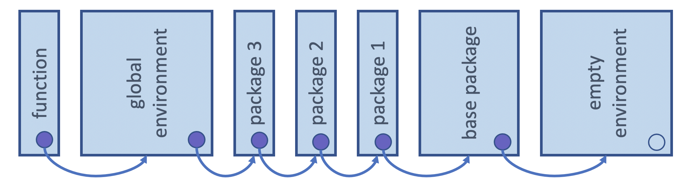
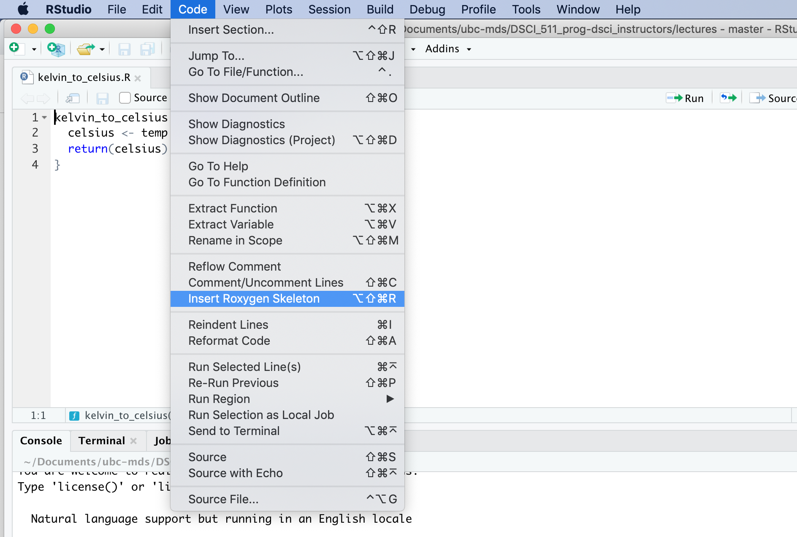

## Defining functions in R:

In this course, we will get to practice writing functions (and then testing them) in the R programming language. Given this has not been covered in the course pre-requisites, we will cover it here briefly. To learn more about functions in R, we refer you to the [functions chapter in the Advanced R book](https://adv-r.hadley.nz/functions.html).

- Use `variable <- function(…arguments…) { …body… }` to create a function and give it a name

Example:


```{r}
#| slideshow: {slide_type: fragment}
add_two_numbers <- function(x, y) {
  x + y
}

add_two_numbers(1, 4)
```

- Functions in R are objects. This is referred to as “first-class functions”.
- The last line of the function returns the object created, or listed there. To return a value early use the special word `return` (as shown below).

```{r}
#| slideshow: {slide_type: slide}
math_two_numbers <- function(x, y, operation) {
  if (operation == "add") {
    return(x + y)
  }
  x - y
}
```

```{r}
math_two_numbers (1, 4, "add")
```

```{r}
math_two_numbers (1, 4, "subtract")
```

### Default function arguments

Default values can be specified in the function definition:

```{r}
#| slideshow: {slide_type: fragment}
math_two_numbers <- function(x, y, operation = "add") {
  if (operation == "add") {
    return(x + y)
  }
  x - y
}
```

```{r}
math_two_numbers (1, 4)
```

```{r}
math_two_numbers (1, 4, "subtract")
```

#### Optional - Advanced

##### Extra arguments via `...`

If we want our function to be able to take extra arguments that we don't specify, we must explicitly convert `...` to a list (otherwise `...` will just return the first object passed to `...`):

```{r}
#| slideshow: {slide_type: skip}
add <- function(x, y, ...) {
    print(list(...))
}
add(1, 3, 5, 6)
```

### Lexical scoping in R

R’s lexical scoping follows several rules, we will cover the following 3:

- Name masking
- Dynamic lookup
- A fresh start

#### Name masking

Object names which are defined inside a function mask object names defined outside of that function. For example, below `x` is first defined in the global environment, and then also defined in the function environment. `x` in the function environment masks `x` in the global environment, so the value of 5 is used in `to_add + x` instead of 10:

```{r}
#| slideshow: {slide_type: fragment}
x <- 10

add_to_x <- function(to_add) {
    x <- 5
    to_add + x
}

add_to_x(2)
```

If a function refers to an object name that is not defined inside the function, then R looks at the environment one level above. And if it is not found there, it again, looks another level above. This will happen all the way up the environment tree until it searches all possible environments for that session (including the global environment and loaded packages).



*__Attribution__: Derived from [Advanced R](https://adv-r.hadley.nz/) by Hadley Wickham*

Here `x` is not defined in the function environment, and so R then looks one-level up to the global environment to try to find `x`. In this case it does and it is then used to calculate `to_add + x`:

```{r}
x <- 10

add_to_x <- function(to_add) {
    to_add + x
}

add_to_x(2)
```

#### Dynamic lookup

R does not look up the values for objects it references when it is defined/created, instead it does this when the function is called. This can lead to the function returning different things depending on the values of the objects it references outside of the function's environment.

For example, each time the function `add_to_x` is run, R looks up the current value of `x` and uses that to compute `to_add + x`:

```{r}
#| slideshow: {slide_type: fragment}
add_to_x <- function(to_add) {
    to_add + x
}

x <- 10
add_to_x(2)

x <- 20
add_to_x(2)
```

#### A fresh start

Functions in R have no memory of what happened the last time they were called. This happens because a new function environment is created, R created a new environment in which to execute it.

For example, even though we update the value of `x` inside the function by adding two to it every time we execute it, it returns the same value each time, because R creates a new function environment each time we run it and that environment has no recollection of what happened the last time the function was run:

```{r}
#| slideshow: {slide_type: fragment}
x <- 10

add_to_x <- function(to_add) {
    x <- to_add + x
    x
}

add_to_x(2)
add_to_x(2)
add_to_x(2)
```

### Lazy evaluation

In R, function arguments are lazily evaluated: they’re only evaluated if accessed.


Knowing that, now consider the `add_one` function written in both R and Python below:

```
# R code (this would work)
add_one <- function(x, y) {
    x <- x + 1
    return(x)
}
```

```
# Python code (this would not work)
def add_one(x, y):
    x = x + 1
    return x
```

Why will the above `add_one` function will work in R, but the equivalent version of the function in python would break?

- Python evaluates the function arguments before it evaluates the function and because it doesn't know what `y` is, it will break even though it is not used in the function.
- R performs lazy evaluation, meaning it delays the evaluation of the function arguments until its value is needed within/inside the function. Since `y` is never referenced inside the function, R doesn't complain, or even notice it.

#### `add_one` in R

```
add_one <- function(x, y) {
    x <- x + 1
    return(x)
}
```

This works:


```
add_one(2, 1)
```

```
3
```

and so does this:


```
add_one(2)
```

```
3
```

#### `add_one` in Python

```
def add_one(x, y):
    x = x + 1
    return x`
```

This works:


```
add_one(2, 1)
```

```
3
```

This does not:


```
add_one(2)
```

```
---------------------------------------------------------------------------
TypeError                                 Traceback (most recent call last)
<ipython-input-5-f2e542671748> in <module>
----> 1 add_one(2)

TypeError: add_one() missing 1 required positional argument: 'y'
```

#### The power of lazy evaluation

Let's you have easy to use interactive code like this:

```{r}
#| slideshow: {slide_type: fragment}
dplyr::select(mtcars, mpg, cyl, hp, qsec)
```

Notes:
- There's more than just lazy evaluation happening in the code above, but lazy evaluation is part of it.
- `package::function()` is a way to use a function from an R package without loading the entire library.

## Exception handling

Sometimes our code is correct but we still encounter errors. This commonly occurs with functions when users attempt to use them in weird and creative ways that the developer did not intend. Developers are well advised to try to anticipate some of this user behaviour and guard against this in a way that can be of help to the user. One way to do this is to have a function fail intentionally when incorrect user input is given.

Imagine we have a simple function to convert temperatures from Fahrenheit to Celsius:

```{r}
fahr_to_celsius <- function(temp) {
  (temp - 32) * 5/9
}
```

What if our user anticipates that our function can handle numbers written as strings? When this happens our users gets a somewhat cryptic error message (which is inversely correlated with their knowledge of the R programming language):

```
fahr_to_celsius("thirty")
```

```
Error in temp - 32: non-numeric argument to binary operator
Traceback:

1. fahr_to_celsius("thirty")
```

This error message is not as helpful as it could be! Also, if this calculation happened to take a long time, it might be nicer to check the data type before we attempt the calculation and then if the wrong data type was given, throw an purposeful error with a more helpful error message. One way we can do this simply in R is using a conditional (i.e., `if` statement) to test the type and then calling `stop` with a useful error message if the type is incorrect.

For example with the `fahr_to_celsius` function, we can use `if(!is.numeric(temp))` to check whether `temp` is not numeric. And then if it is not, `stop` causes a break and the printing out of the more helpful error message "`fahr_to_celsius` expects a vector of numeric values

```{r}
#| slideshow: {slide_type: fragment}
fahr_to_celsius <- function(temp) {
  if(!is.numeric(temp)) {
    stop("`fahr_to_celsius` expects a vector of numeric values")
  }
  (temp - 32) * 5/9
}
```

```
fahr_to_celsius("thirty")
```

```
Error in fahr_to_celsius("thirty"): `fahr_to_celsius` expects a vector of numeric values
Traceback:

1. fahr_to_celsius("thirty")
2. stop("`fahr_to_celsius` expects a vector of numeric values")   # at line 3 of file <text>
```

If you wanted to issue a warning instead of an error, you could use `warning` in place of `stop` in the example above. However, in most cases it is better practice to throw an error than to print a warning...

More advanced exception handling exists in R, and I invite interested learner to read more about it here in the [Condition Handling](http://adv-r.had.co.nz/Exceptions-Debugging.html#condition-handling) and [Defensive Programming](http://adv-r.had.co.nz/Exceptions-Debugging.html#defensive-programming) sections of Advanced R.

## Programming with the `tidyverse` functions

When using `tidyverse` functions,
we can "pretend" that the data frame column names are objects in the global environment
and refer to them without quotations (e.g., `""`).
In this section we use `dplyr` and the `penguins` data set from the `palmerpenguins` package:

```{r}
library(dplyr)
library(palmerpenguins)

penguins |>
  filter(species == "Gentoo", year == 2007)
```

Compare this with the same filter in base R,
where every column name is written out as `penguins$`:

```{r}
penguins[penguins$species == "Gentoo" & penguins$year == 2007, ]
```

However, referring to column names without quotations
leads to problems when we try to use them in a function.
For example,

```{r}
filter_penguins <- function(col, val) {
  filter(penguins, col == val)
}

filter_penguins(species, "Gentoo")
```

Why does `filter` work with non-quoted variable names, but our function `filter_penguins` fail?
`filter` does more behind the scenes than we see:
it captures the code we give it (`col == val`)
and runs that code *inside* the data frame,
so that names which match a column are found as columns first.
This is called **data masking**:
the columns of the data frame "mask" (take priority over) objects with the same name in our environment.
Here, `penguins` has no column called `col`,
so `filter` uses our function's `col` argument instead,
and R then goes looking for an object called `species` in our environment,
which does not exist.
So to make this work for our function, we need to do a little more work too.

Given that this is not a course in R programming,
we will not go into the details of how data masking works here,
but we will show the patterns you need to handle it.
For learners interested to learn more about why this happens,
the [Non-standard evaluation in R](9025-non-standard-evaluation-r.qmd) appendix
rebuilds a simple version of `select()` step by step to show how it works,
and @sec-tidyverse-learn-more at the end of this section lists the `tidyverse` documentation these patterns come from.

### Two kinds of `tidyverse` arguments {#sec-tidyverse-argument-kinds}

Not every `tidyverse` argument handles column names in the same way.
There are two kinds,
and which kind you are using decides which pattern you need:

- **Data masking** arguments let you *compute with* columns,
  as if each column were a variable:
  `filter()`, `mutate()`, `summarise()`, `arrange()`, `group_by()`, `count()`,
  and `aes()` in `ggplot2`.
- **Tidy selection** arguments let you *choose* columns,
  by name, by position or with a helper such as `starts_with()`:
  `select()`, `rename()`, `relocate()`,
  and the `.cols` argument of `across()`.
  `pull()` chooses a single column in a similar way,
  but it has a quirk with column names stored in strings (see @sec-tidyverse-pull).

The help page of each function says which kind each argument is:
look for `<data-masking>` or `<tidy-select>` in the description of the argument
(for example, in `?dplyr::filter` and `?dplyr::select`).

### Where does the column name come from? {#sec-tidyverse-patterns}

The other half of the question is how the column name reaches your code.
There are two common cases:

1. **As a bare name passed into a function you wrote,**
   like `filter_penguins(species, "Gentoo")`.
2. **As a string stored in a variable,**
   like `col <- "species"`.
   This is what you get from command line arguments
   (see the [Non-interactive scripts chapter](0810-scripts.qmd)),
   from configuration files,
   and from a vector of column names you loop over.

Together, the two kinds of arguments and the two cases give four patterns:

|                                                                        | Bare name passed into your function | Column name stored in a string   |
|------------------------------------------------------------------------|-------------------------------------|----------------------------------|
| **Data masking** (`filter()`, `mutate()`, `summarise()`, `group_by()`, `aes()`) | `{{ col }}`                         | `.data[[col]]`                   |
| **Tidy selection** (`select()`, `rename()`, `relocate()`, `across()`)  | `{{ cols }}`                        | `all_of(cols)` or `any_of(cols)` |
| **`pull()`**                                                           | `{{ col }}`                         | `.data[[col]]`                   |

The rest of this section works through each of them.

### Defining `tidyverse` functions by embracing column names: `{{ }}`

The `{{ }}` operator (pronounced "curly curly"), from the `rlang` package,
passes the code your user typed through your function,
so that the `tidyverse` function receives it just as if the user had called it directly.
To use the `{{ }}` operator, we "embrace" the argument when we refer to it inside our function body.

Here's the function we show above working when we use the `{{ }}` operator to "embrace" the unquoted column name:

```{r}
filter_penguins <- function(col, val) {
  filter(penguins, {{ col }} == val)
}

filter_penguins(species, "Gentoo")
```

`{{ }}` works the same way for tidy selection arguments,
so the users of your function can pass anything that `select()` accepts,
including several columns at once and selection helpers:

```{r}
select_penguins <- function(cols) {
  select(penguins, {{ cols }})
}

select_penguins(c(species, island))
```

```{r}
select_penguins(starts_with("bill"))
```

:::{.callout-note}
There are several ways to implement the usage of unquoted column names in R,
and the `{{ }}` operator only works with functions that use data masking or tidy selection,
such as the functions from the `tidyverse`.
Please refer to the [Metaprogramming](https://adv-r.hadley.nz/metaprogramming.html) chapters of Advanced R
if you need to do this with other functions.
:::

### Column names stored in strings {#sec-tidyverse-strings}

When the column name arrives as a string,
`{{ }}` is not the tool to use.
`{{ }}` passes along *code*,
and a variable holding the string `"species"` is not the code `species`.
Worse, the mistake does not cause an error:

```{r}
filter_penguins(col = "species", val = "Gentoo")
```

We get no rows back, because `filter` compared the *string* `"species"` to the string `"Gentoo"`,
which is never true.
Instead, we need to tell the `tidyverse` function
"this is a string: use the column with this name".
How we do that depends on the kind of argument.

#### In data masking arguments: the `.data` pronoun

In data masking arguments, we look the column up in `.data` with double square brackets, `.data[[col]]`:

```{r}
group_col <- "species"
value_col <- "body_mass_g"

penguins |>
  group_by(.data[[group_col]]) |>
  summarise(mean_mass = mean(.data[[value_col]], na.rm = TRUE))
```

This works in any data masking argument,
including `aes()` in `ggplot2`,
which is handy when a script takes the columns to plot as command line arguments:

```{r}
#| fig-alt: "Scatter plot of penguin body mass in grams against flipper length in millimetres."
library(ggplot2)

x_col <- "flipper_length_mm"
y_col <- "body_mass_g"

ggplot(penguins, aes(x = .data[[x_col]], y = .data[[y_col]])) +
  geom_point(na.rm = TRUE)
```

If the string does not match a column name,
`.data[[col]]` stops with an error that names the missing column,
rather than quietly giving you the wrong answer:

```{r}
penguins |>
  summarise(mean_mass = mean(.data[["body_mass"]], na.rm = TRUE))
```

:::{.callout-note}
`.data` is not a data frame.
It is a special object, called a *pronoun*,
that stands for "the columns of the data this function is working on",
and it only works inside data masking arguments.
You can also write `.data$species`,
which makes it explicit that `species` is a column and not an object in your environment,
but only `.data[[col]]` lets you use a column name stored in a variable.
:::

#### In tidy selection arguments: `all_of()` and `any_of()`

In tidy selection arguments, we wrap the strings in `all_of()`:

```{r}
cols <- c("species", "island", "body_mass_g")

penguins |>
  select(all_of(cols))
```

`all_of()` stops with an error if any of the names is not a column,
which catches typos early:

```{r}
penguins |>
  select(all_of(c("species", "flipper_lenght_mm")))
```

`any_of()` is the forgiving version:
it skips names that are not columns.
That is useful when, for example, you want to drop columns that may or may not be in the data:

```{r}
penguins |>
  select(!any_of(c("year", "sex", "comments")))
```

:::{.callout-warning}
## Why not just `select(cols)`?

You will see older code that passes a variable holding strings straight to a tidy selection function,
like `select(cols)`.
This usage is deprecated (since `tidyselect` 1.1.0) because it is ambiguous:
if the data happens to have a column with the same name as your variable,
the column wins,
and you get the wrong columns without any warning.
Here we add a column called `cols` to the data,
and `select(cols)` returns it instead of the `species` and `island` columns we wanted:

```{r}
cols <- c("species", "island")
penguins_extra <- mutate(penguins, cols = 0)

penguins_extra |>
  select(cols)
```

`all_of()` removes the ambiguity: it always treats `cols` as a variable holding column names.

```{r}
penguins_extra |>
  select(all_of(cols))
```

In tidy selection arguments, do not use `.data[[col]]`:
using `.data` there is deprecated (since `tidyselect` 1.2.0),
and `all_of()` is its replacement.
:::

#### In `pull()`: the `.data` pronoun {#sec-tidyverse-pull}

`pull()` chooses a single column,
and the `tidyverse` documentation suggests `all_of()` for it, as for the other tidy selection functions.
However, `pull(all_of(col))` has a quirk:
if the data has a column with the same name as your variable,
`pull()` returns that column, even inside `all_of()`,
without an error or a warning
([tidyselect issue #376](https://github.com/r-lib/tidyselect/issues/376)).
Here our variable is called `col`, and we add a column called `col` to the data:

```{r}
col <- "body_mass_g"
penguins_col <- mutate(penguins, col = 0)

penguins_col |>
  pull(all_of(col)) |>
  mean(na.rm = TRUE)
```

We get the mean of the column called `col` (0),
not of `body_mass_g`.
`.data[[col]]` does not have this problem,
so we use it with `pull()`:

```{r}
penguins_col |>
  pull(.data[[col]]) |>
  mean(na.rm = TRUE)
```

Most of the time your data will not have a column with the same name as your variable,
and both give the same answer.
But in a script or a function, you do not know in advance which columns the data will have,
so it is safer to use the version that cannot go wrong.
The [Non-standard evaluation in R](9025-non-standard-evaluation-r.qmd) appendix explains why these collisions happen.

#### Several columns from strings in data masking arguments: `pick()` and `across()`

Data masking functions such as `group_by()` and `summarise()` often need several columns at once.
To use a tidy selection inside a data masking argument,
wrap it in `pick()`, to use the selected columns as they are,
or in `across()`, to apply a function to each of the selected columns:

```{r}
group_cols <- c("species", "island")
value_cols <- c("bill_length_mm", "body_mass_g")

penguins |>
  group_by(pick(all_of(group_cols))) |>
  summarise(
    across(all_of(value_cols), \(x) mean(x, na.rm = TRUE)),
    .groups = "drop"
  )
```

`pick()` and `across()` take `{{ }}` as well,
so the same function can also accept bare names from its users:
`group_by(pick({{ group_cols }}))`.

### The walrus operator `:=` is needed when assigning values

For similar reasons, the walrus operator (`:=`) is needed when writing functions that create new columns using unquoted column names with the `tidyverse` functions.
R does not allow code on the left-hand side of `=` when naming an argument,
so `tidyverse` functions accept `:=` in its place:

```{r}
group_summary <- function(data, group, col, fun) {
  data |>
    group_by({{ group }}) |>
    summarise({{ col }} := fun({{ col }}, na.rm = TRUE))
}

group_summary(penguins, species, body_mass_g, mean)
```

The left-hand side of `:=` can also be a template for the new column's name,
using the syntax of the [`glue` package](https://glue.tidyverse.org/):
`{{ }}` inserts the name of an embraced argument,
and `{ }` inserts the value of a variable holding a string.

```{r}
mean_by <- function(data, group, col) {
  data |>
    group_by({{ group }}) |>
    summarise("mean_{{ col }}" := mean({{ col }}, na.rm = TRUE))
}

mean_by(penguins, species, body_mass_g)
```

```{r}
col <- "body_mass_g"

penguins |>
  summarise("mean_{col}" := mean(.data[[col]], na.rm = TRUE))
```

### Older patterns: `!!`, `enquo()` and `sym()`

In older code, blog posts and Stack Overflow answers,
you will see other ways of doing the same things.
They come from earlier versions of the `tidyverse`,
before `{{ }}`, `.data` and `all_of()` were the recommended tools:

| Older pattern                                         | Use instead                                                           |
|-------------------------------------------------------|-----------------------------------------------------------------------|
| `col <- enquo(col)`, then `!!col`                     | `{{ col }}`                                                           |
| `!!sym(col)` or `!!as.name(col)` for a string         | `.data[[col]]` in data masking and `pull()`, `all_of(col)` in tidy selection |
| `!!!syms(cols)`, for several strings                  | `pick(all_of(cols))` or `across(all_of(cols))` in data masking, `all_of(cols)` in tidy selection |
| `select(cols)`, with `cols` holding strings           | `select(all_of(cols))`                                                |
| `aes_string(x = col)` in `ggplot2`                    | `aes(x = .data[[col]])`                                               |

`!!` is not deprecated, and most of the older patterns still work.
What is deprecated is
`aes_string()` (since `ggplot2` 3.0.0),
passing a variable holding strings straight to a tidy selection function (since `tidyselect` 1.1.0),
and using `.data` inside tidy selection functions (since `tidyselect` 1.2.0).
`{{ }}` is shorthand for `!!enquo()`,
and `!!` (the "injection" operator) and `!!!` (the "splice" operator)
are still the right tools for more advanced metaprogramming;
the [Non-standard evaluation in R](9025-non-standard-evaluation-r.qmd) appendix shows how they work.

### Learn more {#sec-tidyverse-learn-more}

The patterns in this section come from the `tidyverse` documentation:

- [Programming with `dplyr`](https://dplyr.tidyverse.org/articles/programming.html):
  `{{ }}` for function arguments, `.data[[var]]` in data masking, and `all_of()` in tidy selection.
- The `dplyr` reference pages for [data masking](https://dplyr.tidyverse.org/reference/dplyr_data_masking.html)
  and [tidy selection](https://dplyr.tidyverse.org/reference/dplyr_tidy_select.html) arguments.
- [Data mask programming patterns](https://rlang.r-lib.org/reference/topic-data-mask-programming.html),
  from the `rlang` documentation,
  including `across(all_of(vars))` to use a vector of column names in a data masking function.
- [The data mask ambiguity](https://rlang.r-lib.org/reference/topic-data-mask-ambiguity.html),
  on collisions between column names and objects in your environment,
  and how the `.data` and `.env` pronouns prevent them.
- [The injection operator `!!`](https://rlang.r-lib.org/reference/injection-operator.html)
  and [embracing with `{{`](https://rlang.r-lib.org/reference/embrace-operator.html),
  in the `rlang` documentation.

The deprecations mentioned in this section are documented in:

- [Using an external vector in selections](https://tidyselect.r-lib.org/reference/faq-external-vector.html),
  the `tidyselect` FAQ on `select(cols)` versus `select(all_of(cols))`.
- [tidyselect 1.2.0](https://www.tidyverse.org/blog/2022/10/tidyselect-1-2-0/),
  the release post that deprecated `.data` in tidy selection.
- [`aes_()` and `aes_string()`](https://ggplot2.tidyverse.org/reference/aes_.html)
  and [Using ggplot2 in packages](https://ggplot2.tidyverse.org/articles/ggplot2-in-packages.html),
  in the `ggplot2` documentation.
- [tidyselect issue #376](https://github.com/r-lib/tidyselect/issues/376),
  the `pull(all_of())` quirk.

To learn how it all works underneath:

- The [Non-standard evaluation in R](9025-non-standard-evaluation-r.qmd) appendix.
- [Metaprogramming](https://adv-r.hadley.nz/metaprogramming.html), in Advanced R.
- [Learning Tidy Evaluation by Reimplementing `dplyr`](https://www.youtube.com/watch?v=WoBbQ5gsbgU)
  ([slides and code](https://github.com/chendaniely/rstatsdc-2020-tidyeval)),
  a talk by Daniel Chen that rebuilds `select()` step by step
  to explain quoting, quosures and the data mask.
  It was recorded in 2020, so a few of its patterns have since been superseded:
  use `aes(x = .data[[col]])` instead of `aes_string()`,
  `all_of(col)` instead of passing a variable holding a string straight to `select()`,
  and `.data[[col]]` instead of `rlang::parse_expr()` with `!!`.

## Function documentation

Function documentation is extremely useful at both the time of function creation/development, as well as at the time of function usage by the user. At the time of creation/development, it is useful for clearly delineating and communication the planned function's specifications. At the time of usage, it is often the primary documentation a user will refer to in order to understand how to use the function. If a function is not well documented, it will not be well understood or widely used.

### Function documentation in R

In R, we write function documentation in a style that the
[`roxygen2` R package](https://roxygen2.r-lib.org/)
can use to automatically generate nicely formatted documentation,
accessible via R's help function,
when we create R packages.
This is not available to us until we package our functions in software packages,
however it is a good practice to get into because it helps ensure you document the key aspects of a function for your user,
and it means that when you go to create an R package to share your function,
you will have already correctly formatted the function documentation,
saving future you some work!

```{r}
#| slideshow: {slide_type: fragment}
#' Converts temperatures from Fahrenheit to Celsius.
#'
#' @param temp a vector of temperatures in Fahrenheit
#'
#' @return a vector of temperatures in Celsius
#'
#' @examples
#' fahr_to_celcius(-20)
fahr_to_celsius <- function(temp) {
    (temp - 32) * 5/9
}
```

RStudio has a nice feature to provide a `roxygen2` formatted skeleton for function documentation. To use it, you put the cursor in the function definition, and then select the menu items "Code" > "Insert Roxygen Skeleton":



## Practice writing functions in R

To practice writing functions in R, you can attempt this worksheet: https://github.com/UBC-DSCI/dsci-310-student/blob/main/practice/worksheet_functions_in_r.ipynb

*Note: to access the automated software tests for feedback on your answers, you will want to clone or download [this GitHub repo](https://github.com/UBC-DSCI/dsci-310-student) and navigate to the `practice` directory.*

## Defining functions in Python

In this course, we will get to practice writing functions (and then testing them) in the Python programming language. We will only cover it here briefly. To learn more about functions in Python, we refer you to the [Module 6: Functions Fundamentals and Best Practices
](https://prog-learn.mds.ubc.ca/en/module6) from the Programming in Python for Data Science course.

Functions in Python are defined using the reserved word `def`. A colon follows the function arguments to indicate where the function body should starte. White space, in particular indentation, is used to indicate which code belongs in the function body and which does not. A general form for fucntion definition is shown below:

```
def function_name(…function arguments…):
    …function body…
```

Here's a working example:

```{r}
#| slideshow: {slide_type: fragment}
add_two_numbers <- function(x, y) {
  x + y
}

add_two_numbers(1, 4)
```

- Functions in R are objects. This is referred to as “first-class functions”.
- The last line of the function returns the object created, or listed there. To return a value early use the special word `return` (as shown below).

```{r}
#| slideshow: {slide_type: slide}
math_two_numbers <- function(x, y, operation) {
  if (operation == "add") {
    return(x + y)
  }
  x - y
}
```

```{r}
math_two_numbers (1, 4, "add")
```

```{r}
math_two_numbers (1, 4, "subtract")
```

### Default function arguments

Default values can be specified in the function definition:

```{r}
#| slideshow: {slide_type: fragment}
math_two_numbers <- function(x, y, operation = "add") {
  if (operation == "add") {
    return(x + y)
  }
  x - y
}
```

```{r}
math_two_numbers (1, 4)
```

```{r}
math_two_numbers (1, 4, "subtract")
```

#### Optional - Advanced

##### Extra arguments via `...`

If we want our function to be able to take extra arguments that we don't specify, we must explicitly convert `...` to a list (otherwise `...` will just return the first object passed to `...`):
